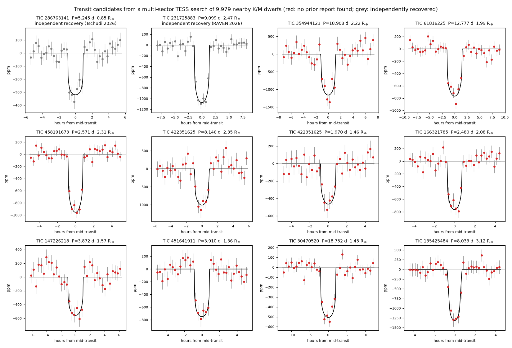
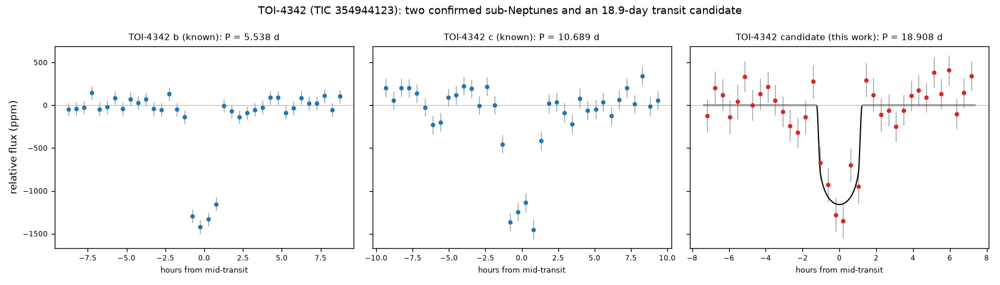
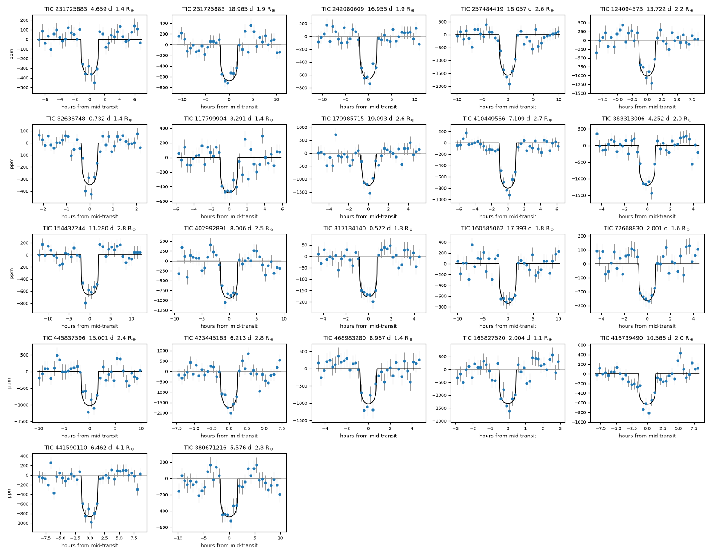
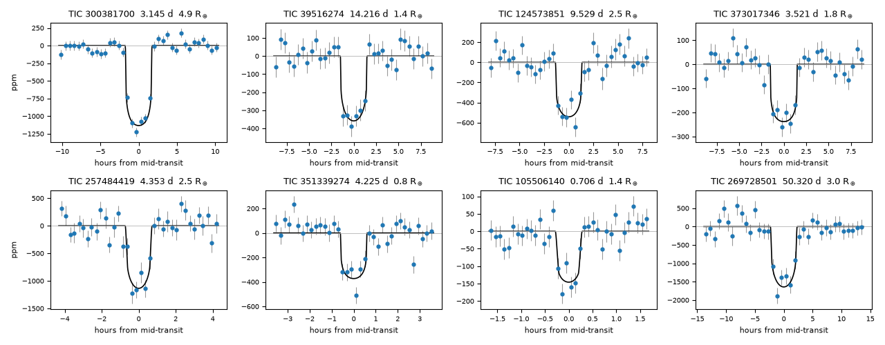
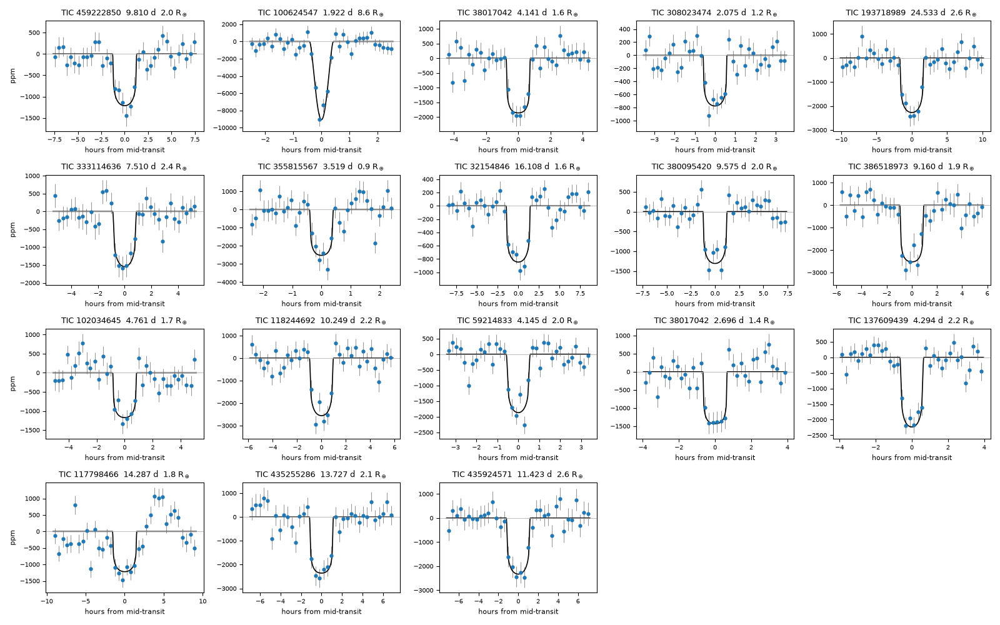
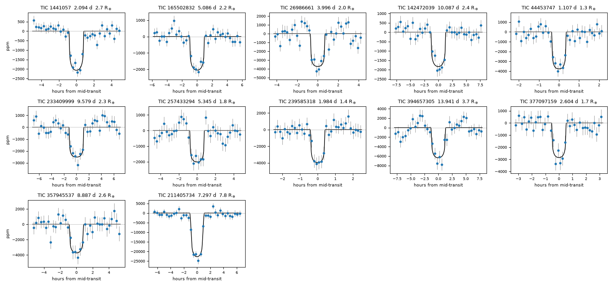
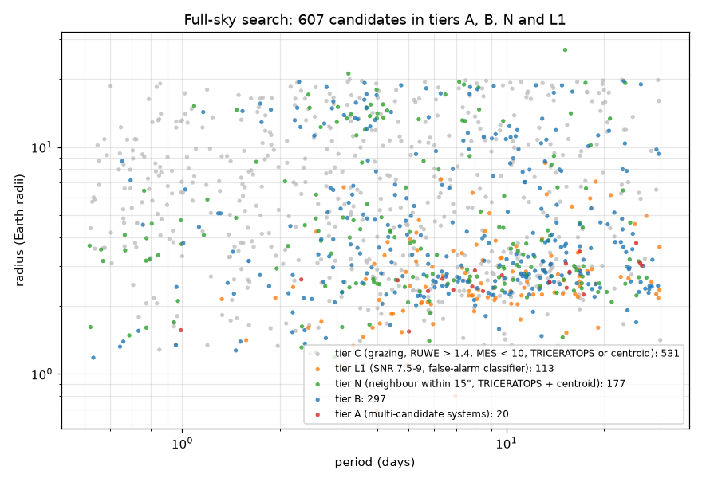

# Multi-sector TESS transit searches of nearby K and M dwarfs and of TOI hosts

**Small transiting-planet candidates in NASA TESS light curves, with the code, tables and vetting behind each one.**

<p align="center">
  <a href="https://eumemic.github.io/exoplanets/">Website</a> &nbsp;&middot;&nbsp;
  <a href="https://eumemic.github.io/exoplanets/candidates.html">Candidate explorer</a> &nbsp;&middot;&nbsp;
  <a href="https://eumemic.github.io/exoplanets/transits.html">Transit planner</a> &nbsp;&middot;&nbsp;
  <a href="https://eumemic.github.io/exoplanets/methods.html">Methods</a> &nbsp;&middot;&nbsp;
  <a href="results_public/">Data</a>
</p>

Independent searches of NASA TESS light curves for small transiting planets. The first combines
the newest TESS sectors (97–105) with every earlier sector of 9,979 nearby K and M dwarfs. The
second, added on 8 October 2026, looks for additional planets around the hosts of 6,430 TESS
Objects of Interest (TOIs) after masking the known TOIs.

- **TRICERATOPS corrections (15 October 2026): 644 candidates.** Checks of the single-cadence rerun's outputs, made
  after its release, found runs that had gone wrong without an error, and rows the rerun had not covered. On the machine
  that ran out of memory and was restarted, the field-star population query failed for 353 targets, so TRICERATOPS left
  out its six diluted and background-star scenarios. A full disk or the restart had cut MOLUSC's files of simulated
  companions short for 63 signals (about 6,000–11,000 survivors, against 88,000–166,000 when the same stars were run
  again), which lowered their Gaia-limited FPPs. For 39 targets the TIC gives no parallax; TRICERATOPS then stops before computing anything and returns equal
  probabilities for every scenario, which the catalog had published as results (none of the 39 was counted, and their
  TRICERATOPS columns are now empty). Two 10-minute folds had not been binned in phase as described. And 1,068 rows with
  TRICERATOPS values but no Gaia-limited runs, among them 820 likely nearby false positives, were still on the
  mixed-cadence input. Every signal with TRICERATOPS values was rerun on single-cadence light curves, ten runs with the
  default priors and ten with the Gaia limits, and each result was checked (`pipeline/fpp_check.py`). Neighbour signals
  that now pass the TRICERATOPS bar were fitted and tested in every sector, as the tier N candidates were, and rows
  whose fitted ephemeris differed from the one TRICERATOPS had used were rerun with it. 19 signals change tier: 11 likely
  nearby false positives become tier N (3 of them larger than 8 R⊕), 3 tier C signals of 17–19 R⊕ become tier B, 3 tier
  B candidates move to tier C, TIC 410449566 of the earlier searches returns to tier A, and TIC 201310621 moves from tier
  C to likely nearby false positive (it now passes TRICERATOPS, but its per-sector centroids reject the target and fit a
  neighbour 18″ away). The three that leave are
  TIC 160420269 of issue #1 (17 R⊕, `FPP_gc` 0.59), TIC 311646629 (17 R⊕, 0.50) and TIC 370244729 (no Gaia-limited
  runs, `FPP_c` 0.50). For signals this deep the ten runs scatter widely (TIC 160420269: 0.02 to 0.98), so their tiers
  are uncertain. 252 counted candidates (224 full-sky and 28 from the earlier searches) meet the validation thresholds
  apart from high-resolution imaging, against 267; 13 of the 20 that drop below them had runs without the background
  scenarios or with a cut-off MOLUSC file. The flag columns now follow their stated rules, and each candidate folder
  holds the current TRICERATOPS result. 586 full-sky candidates and 58 from the earlier searches
  ([details](validation/triceratops_single_cadence.md#corrections-15-october-2026-evening)).
- **TRICERATOPS with single-cadence light curves (15 October 2026): 632 candidates.** TRICERATOPS models one exposure
  time, but each signal's TRICERATOPS input had combined every sector (30-minute, 10-minute, 200-second and 2-minute
  data), binned to 5 minutes and modelled with a 10-minute exposure. For some deep signals this made the FPP far too
  small: TIC 160420269 (17 R⊕) had FPP below 1e-7 where its 200-second data alone give about 0.4 (found by Antoine
  Rabtsevich, [issue #1](https://github.com/eumemic/exoplanets/issues/1)). All 1,299 signals with Gaia-limited
  TRICERATOPS runs were rerun on the transits of one cadence, the one whose in-transit points carry the most
  information, modelled with that cadence's exposure (10- and 30-minute data binned in phase to 2 minutes), with ten
  runs with the default priors and ten with the Gaia limits as before. The median `FPP_gc` of the counted candidates is
  unchanged at 0.013, but 55 signals change tier. 25 tier N candidates now fail NFPP < 0.1 or FPP < 0.5 and become likely
  nearby false positives (7 of them had been flagged by the per-sector centroid test, and 12 have centroid ratios that
  favour a neighbour). 13 tier B candidates, 9 of them larger than 8 R⊕, and one earlier-search tier A candidate move
  to tier C, and one tier L1 candidate returns to tier L. 14 tier C signals now pass and are counted, among them both
  signals of TIC 229511659 (tier A). 267 counted candidates (240 full-sky and 27 from the earlier searches) meet the
  validation thresholds apart from high-resolution imaging, against 288. 575 full-sky candidates and 57 from the
  earlier searches ([details](validation/triceratops_single_cadence.md)).
- **TESS Ten Thousand eclipsing binaries (15 October 2026): 658 candidates.** We matched the catalog against
  machine-readable tables of TESS full-frame-image candidates and eclipsing binaries, which the literature search does
  not always find. Three tier B candidates are eclipsing binaries in the TESS Ten Thousand catalog (Kostov et al. 2025):
  TIC 61754177 (1.88 d, half the binary's period), TIC 269693249 (2.32 d) and TIC 390928439 (8.14 d). They and one tier C
  signal become likely EBs. DIAmante (Montalto et al. 2020), DTARPS-S (Melton et al. 2024) and Olmschenk et al. (2021)
  list none of the counted candidates. The findability tables drop the three, leaving 487. 600 full-sky candidates and
  58 from the earlier searches ([details](validation/catalog_crossmatch.md)).
- **Validation thresholds only below 8 Earth radii (15 October 2026).** The TRICERATOPS validation thresholds (FPP <
  0.015, NFPP < 0.001) apply only to candidates smaller than 8 R⊕ (Giacalone et al. 2021): giant planets, brown dwarfs
  and low-mass stars cannot be told apart by radius. 13 of the 301 counted candidates that meet the thresholds are
  larger, so 288 (253 full-sky and 35 from the earlier searches) meet them apart from high-resolution imaging. Pointed
  out in [issue #1](https://github.com/eumemic/exoplanets/issues/1).
- **TRICERATOPS combined with the centroid ratio from run means (14 October 2026): 661 candidates.** The combined
  probabilities `FPP_c` and `FPP_gc` used the mean FPP of ten TRICERATOPS runs with the largest NFPP of the ten. When the
  runs disagree, the largest NFPP can exceed the mean FPP, and 22 rows, 15 of them counted, had negative values. Both
  now use the means of the same runs (`NFPP_c` keeps the largest NFPP, which is conservative); 786 values of `FPP_c` and
  351 of `FPP_gc` change by more than 0.0015. Two candidates now fail FPP < 0.5, both narrowly: TIC 238187210 (26.03 d,
  tier B) moves to tier C and TIC 387221443 (15.20 d, tier N) to likely nearby false positive. Checking every tier
  against its rules also found two grazing tier N candidates from the QLP re-search, TIC 279052784 (1.17 d, b = 0.93) and
  TIC 188129917 (3.26 d, b = 1.02), which move to tier C. The findability tables now cover the 490 candidates left in
  tiers A, B and N. 603 full-sky candidates and 58 from the earlier searches ([details](validation/fpp_combination.md)).
- **TIC 206609457 joins tier L1 (14 October 2026): 665 candidates.** This 13.33-day signal (6.2 R⊕, SNR 7.5–9)
  passes the false-alarm classifier (hold-out score 0.84) but stayed in tier L because it had only the default
  TRICERATOPS run, whose NFPP (0.103) was just above the 0.1 limit; that run included three capable stars 44–63″ away.
  The Gaia-constrained TRICERATOPS run and the per-sector centroid test used for tier L1 give FPP 0.041 and NFPP 0
  (nearby-star scenarios within 30″, as for the other L1 candidates), so it joins tier L1. Its centroid lies 15–38″
  west of the star in all four sectors, where the TIC lists no star bright enough to cause the dip. The test gives
  p = 0.004 for the star as the source and p < 0.001 for each capable neighbour, so the row carries `centroid_flag`, as
  do three other L1 candidates. 607 full-sky candidates and 58 from the earlier searches.
- **Website (13 October 2026).** [eumemic.github.io/exoplanets](https://eumemic.github.io/exoplanets/) has an abstract
  of the search, a candidate explorer, a transit planner and the methods (first built in PR #8). Every number on it is
  computed from the tables in this repository when the site is built on each push to `main`: the candidate tables,
  the predictions, the validation tables, the dated notes here, and a new table of stage counts of the search,
  [`results_public/funnel_allsky.csv`](results_public/funnel_allsky.csv), written by `pipeline/funnel.py` from the
  search's output tables. The findability tables now cover the current 494 candidates in tiers A, B and N
  ([details](validation/findability.md)).
- **Community TOIs under another period (13 October 2026): 664 candidates.** Seven counted tier B candidates are
  the same transits as community TOIs (CTOIs) that give a single transit or another period (163.2, 740.0 or 9.4 days:
  7, 44 or 3/7 times ours). Our known-signal check compared periods only, so it missed them. They and three tier C
  signals are now labelled reported, with the CTOI in the new column `reported_as`. The check now also matches a known
  object whose epoch falls inside one of our transits when its period is missing or a simple fraction of ours. 606
  full-sky candidates and 58 from the earlier searches ([details](validation/ctoi_matches.md)).
- **QLP re-search (13 October 2026): 671 candidates.** With the reader fix from PR #6, 1,770,906 full-sky stars (44%)
  gained QLP light curves, so we searched them again. A pilot found that QLP's corrected flux in Sectors 94–104 dips or
  rises for several hours at the start and end of each orbit, which mimics transits at ~13 days; we now drop the first
  day and the last half day of each orbit's QLP data in those sectors. QLP Sectors 74–79, re-delivered by MAST as
  version 2, were also missing from our light-curve index (issue #9, PR #12) and are now included. The re-search found
  302 new clean signals and 262 new signals whose only pixel flag is a capable neighbour within 15″. After the same
  checks as before, 120 are counted (6 A, 51 B, 25 N, 38 L1); none is reported in ADS or Zenodo. The false-alarm
  classifier was retrained with the re-searched signals and tier L1 re-selected (6 leave, 28 join). The binary check
  now moves TIC positions to the Gaia epoch (PR #13), which gives 3 counted candidates a RUWE above 1.4 (to tier C).
  TIC 141937667 (13.36 d), which drew 59% of its signal from orbit edges and disappears with the mask, is now a likely
  false alarm. 613 full-sky candidates and 58 from the earlier searches
  ([details](validation/qlp_orbit_edges.md), [classifier](validation/false_alarm_classifier.md#retraining-after-the-qlp-re-search-13-october-2026)).
- **Tier L1 re-selected, and a data gap found (13 October 2026): 533 candidates.** An outside contributor showed
  that the false-alarm classifier's validation let signals from the same star appear in training and evaluation
  (PR #4, merged). With validation grouped by star, 8 tier L1 candidates fall below the 0.80 score cut and leave; 11
  signals that now reach it pass the L1 checks (TRICERATOPS with Gaia limits, per-sector centroids) and join:
  473 full-sky candidates and 60 from the earlier searches
  ([details](validation/false_alarm_classifier.md#re-selection-of-tier-l1-13-october-2026)). The same contributor
  found that our reader dropped QLP light curves whose uncertainty column is empty (PR #6, merged). In the earlier
  searches that removed 24–82% of the QLP light curves in Sectors 94–97 and 101–104, and we estimate about 900,000
  such light curves were missing from the full-sky search (re-searched later the same day, above). Separately, MAST reports a QLP timing error from the second
  half of Sector 99 to Sector 104 whose corrected files are not yet delivered; fits that use those sectors may shift by
  minutes.
- **TIC artifacts removed (13 October 2026): 530 candidates.** Our neighbour checks and TRICERATOPS had counted TIC
  entries that are not stars (flagged ARTIFACT or DUPLICATE; Paegert et al. 2021). Without them, 7 tier N candidates
  have no neighbour within 15″ and become tier B, and two earlier-search signals set aside only for such an entry are
  now counted: a 3.1 R⊕ candidate at 27.0 d around WASP-166 (flagged for its centroid offset) and a 1.2 R⊕ candidate
  at 2.28 d around an M dwarf 36 pc away. 470 full-sky candidates and 60 from the earlier searches
  ([details](validation/tic_artifacts.md)).
- **Centroids in every sector (12 October 2026): 528 candidates.** The pixel checks had used the centroid offset of
  one difference image. We now measure it in every sector with transits, in arcseconds east and north of the target,
  and test whether the mean offset over the sectors is consistent with the target and with each star within 2′
  bright enough to cause the dip (an F-test against the scatter between sectors, taken as at least 1″ per axis). On
  565 known planets the test never rejects the target at p < 0.001; on 175
  signals known to come from neighbouring stars it does so 73% of the time. 18 counted candidates reject their target
  at p < 0.001 and leave the counted tiers (16 to likely nearby false positive, 2 to tier C), and 13 more at p < 0.01
  are flagged: 470 full-sky candidates and 58 from the earlier searches ([details](validation/centroid_sectors.md)).
- **Why earlier searches missed these signals (12 October 2026).** The data are not new. With only the transits
  observed through Sector 55 (September 2022), 47% of the full-sky candidates in tiers A, B and N already reach
  SNR 9, and 93% with those through Sector 96; only 24 needed Sectors 97–104. What hid them is that they are weak in
  any one sector (half never reach SPOC's threshold of 7.1 in a single sector) and that 82% are on stars observed only
  in full-frame images, which SPOC's multi-sector searches do not cover. Of the 78 with 2-minute data, re-measured in
  SPOC's own light curves, 7 reach 7.1 with our noise estimate and 2 with SPOC's
  ([details](validation/findability.md)).
- **Gaia limits on companions (11 October 2026): 546 candidates.** We reran TRICERATOPS on every counted
  candidate with limits from Gaia DR3: MOLUSC removes bound companions that Gaia would have resolved or
  that would raise the star's RUWE, and for bright stars the Gaia epoch RVs rule out an eclipsing binary
  on the target. The median false-positive probability falls from 0.042 to 0.013, and 236 candidates
  meet the validation thresholds apart from high-resolution imaging (62 before). With the same bar
  applied to the constrained values in both directions, 5 candidates left and 10 joined, and two stars
  that Gaia shows to be spectroscopic binaries moved to likely eclipsing binaries: 488 full-sky
  candidates and 58 from the earlier searches
  ([details](validation/gaia_companion_limits.md)).
- **Full-sky search, second release (9 October 2026): 543 candidates**, 483 of them (tiers A, B, N and L1 below)
  from 4.04 million FGKM dwarfs brighter than T = 13.5, combining all of their TESS sectors (1–104), and 60 from the
  earlier searches.
  Every one passes TRICERATOPS (FPP < 0.5, NFPP < 0.1) and a false-alarm test calibrated on the
  inverted light curves of 800,000 stars. New in this release: 169 tier N candidates recovered from
  crowded fields with TRICERATOPS and a centroid test calibrated on 1,000 known planets; 51 tier L1
  candidates, mostly small planets, picked out of the noisy SNR 7.5–9 band by a false-alarm classifier;
  and TRICERATOPS for every tier A and B candidate. The stricter checks moved 137 first-release
  candidates to tier C. With the 60 earlier candidates below, the running total is **543 candidates**.
- **First release (7 October 2026):** 10 transit-candidate signals on 9 stars for which we found
  no prior report, including a possible third transiting planet in the TOI-4342 system, and two
  signals that others had reported earlier in 2026.
- **Update (8 October 2026):** 20 more candidates for which we found no prior report:
  6 from completing the fully coherent search of the K/M dwarfs and 14 from the TOI-host search,
  plus two further signals on TIC 231725883. Every TOI-host candidate is on a star that already
  has a TOI, which makes it less likely to be a false positive.
- **Update 2 (8 October 2026):** 6 more candidates for which we found no prior report, from
  re-checking SPOC detections that have not become TOIs and from a search for periods of 20–100
  days, plus independent recoveries of 2 signals that other independent researchers posted on
  Zenodo days earlier. They include possible second planets around the confirmed-planet hosts
  TOI-669 (matching a weak radial-velocity signal) and TOI-5997, a 50.3 d signal on TOI-4566, and a
  sub-Earth-sized signal on GJ 774, an M-dwarf pair 13 pc away.
- **Update 3 (8 October 2026):** 18 more from a search of 22,448 fainter M dwarfs
  (11.5 < T ≤ 12.5), including GJ 3514, an M4.5 dwarf 17.6 pc away, and a star with two signals.
  The same search found two of our earlier candidates again, and one signal that another
  independent project had posted on GitHub three days earlier.
- **Update 4 (8 October 2026):** 12 more from the faintest M dwarfs searched so far
  (12.5 < T ≤ 13.5, 84,863 stars), including LHS 1083 (36 pc) and a possible member of the young
  Octans association.

**These are planet candidates, not confirmed planets.** Each passes automated and pixel-level
vetting, but TESS alone cannot rule out every false-positive scenario. Ground-based photometry,
high-resolution imaging, or radial velocities are needed to confirm or reject them.



## What is in this repository

| | |
|---|---|
| **Candidate tables** | Every signal found, the vetted signals, the candidate table of each search, the search's stage counts and the novelty check, with a [data dictionary](results_public/README.md). [`results_public/`](results_public/) |
| **A folder per candidate** | Vetting plot, transit fit, centroid offsets, nearby stars and TRICERATOPS output for each candidate; the full-sky ones are in [`candidates/allsky/`](candidates/allsky/). [`candidates/`](candidates/) |
| **Transit predictions** | The ephemeris of each registered candidate and its predicted transit times, committed before the observations. [`candidates/ephemerides.csv`](candidates/ephemerides.csv), [`candidates/predictions.csv`](candidates/predictions.csv) |
| **Validation** | Control stars, injection–recovery and false-alarm tables, and a note for each check added since the first release. [`validation/`](validation/) |
| **Pipeline** | The search, vetting and follow-up code; how to run it is under [Reproducing](#reproducing). [`pipeline/`](pipeline/), tests in [`tests/`](tests/) |
| **Figures** | The figures shown here. [`figures/`](figures/) |
| **Explainer video** | A short film built in Remotion from the repository's own data, and how to render it. [`video/`](video/) |
| **Website** | An abstract of the search, a candidate explorer, a transit planner and the methods, with every number computed from these tables. [eumemic.github.io/exoplanets](https://eumemic.github.io/exoplanets/) |

## Candidates

Radii use TIC 8.2 stellar radii. FPP is the TRICERATOPS false-positive probability from TESS
data alone (no follow-up imaging, no multiplicity boost), averaged over 10 runs from the update
onwards; the statistical-validation threshold is FPP < 0.015.

### First release (7 October 2026)

| TIC | Period (d) | Radius (R⊕) | Host (Teff, distance) | FPP | Status |
|---|---|---|---|---|---|
| 354944123 (TOI-4342) | 18.90820 | 2.21 ± 0.11 | 3880 K, 62 pc | 0.14 | no prior report found; third transiting signal in a system with two confirmed planets |
| 61816225 | 12.77703 | 1.99 ± 0.06 | 4380 K, 57 pc | 0.03 | no prior report found |
| 458191673 | 2.570687 | 2.31 ± 0.07 | 4470 K, 66 pc | 0.03 | no prior report found |
| 422351625 | 8.14641 | 2.35 ± 0.16 | 4410 K, 93 pc | – | no prior report found; second signal on the same star ↓ |
| 422351625 | 1.969879 | 1.46 ± 0.09 | 4410 K, 93 pc | – | no prior report found |
| 166321785 | 2.480128 | 2.08 ± 0.09 | 4380 K, 96 pc | – | no prior report found; two T≈15–16 stars at 9″ |
| 147226218 | 3.87159 | 1.57 ± 0.08 | 4840 K, 77 pc | – | no prior report found; T=16.6 star at 3.4″ |
| 451641911 | 3.90974 | 1.36 ± 0.05 | 3650 K, 41 pc | – | no prior report found; crowded field |
| 30470520 | 18.75190 | 1.45 ± 0.04 | 5150 K, 208 pc | – | no prior report found; crowded field, depth varies by sector; now tier C (Gaia RUWE 11.6) |
| 135425484 | 8.03350 | 3.12 ± 0.15 | 4230 K, 79 pc | – | no prior report found; impact parameter 0.91 (near-grazing); now tier C (grazing) |
| 286763141 (TOI-6284) | 5.244548 | 0.85 ± 0.04 | 3550 K, 21 pc | 0.03 | independent recovery; reported as "TOI-6284.02" by [Tschudi 2026](https://arxiv.org/abs/2607.23781) |
| 231725883 | 9.098778 | 2.47 ± 0.07 | 5110 K, 155 pc | – | independent recovery; in the RAVEN first-stage detection list ([Lafarga et al. 2026](https://arxiv.org/abs/2603.22597)), not in their vetted list; the update finds two more signals on this star |

Each candidate has a folder in [`candidates/`](candidates/) with the vetting plot and metrics,
the transit fit (P, T0, Rp/R*, b, ρ*), PRF centroid offsets, nearby stars bright enough to mimic
the signal, and the TRICERATOPS result where computed. All parameters are in
[`results_public/candidates.csv`](results_public/candidates.csv).

### TOI-4342: a third transiting candidate



TOI-4342 b and c are confirmed sub-Neptunes at 5.54 and 10.69 d
([Tey et al. 2023](https://arxiv.org/abs/2301.01370); masses from
[ESPRESSO, 2026](https://arxiv.org/abs/2601.22115), which also reports a probably non-transiting
47.5 d RV candidate). We find a third transit signal at 18.9082 d with the same radius as b and c
(2.2 R⊕), with transits in 8 sectors (11σ in Sectors 13–93, 7σ in 101–103). The difference-image centroid
is within 7–16″ of the star in each 2-min sector, and no star within 30″ is bright enough to
produce the dip. Its predicted RV semi-amplitude is about 2 m/s. The TOI-host search, which masks
b and c before searching, finds it again as the strongest remaining signal.

### Added 8 October 2026

These passed every check: no match in the ExoFOP TOI and CTOI lists, the NASA Exoplanet
Archive, the SPOC TCE tables or the literature check (below); all 17 LEO-Vetter tests; MES ≥ 7.1;
per-sector depths consistent (χ²/dof ≤ 5); a difference-image centroid within 15″ of the target;
no TIC star within 15″ bright enough to produce the dip; and no report found by a web search on
each TIC ID and host TOI ([`novelty_check.md`](results_public/novelty_check.md)). "Known on star" lists the TOIs
(with TFOPWG disposition) on the same star.



| TIC | Period (d) | Radius (R⊕) | Host (Teff, T mag, distance) | Known on star | FPP | Notes |
|---|---|---|---|---|---|---|
| 32636748 | 0.732324 | 1.43 | 4094 K, 10.4, 55 pc | – | unstable | K/M dwarfs; ultra-short period; TRICERATOPS gives 0.00–0.98 over 10 runs for this 0.7 h transit; now tier C (Gaia RUWE 1.73) |
| 117799904 | 3.291093 | 1.39 | 4045 K, 10.9, 61 pc | TOI-2457.01 (PC, 14.20 d) | 0.053 | K/M dwarfs; second signal on TOI-2457 (found by both searches); now tier C (Gaia RUWE 1.55) |
| 124094573 | 13.721761 | 2.18 | 4590 K, 11.4, 110 pc | – | 0.068 | K/M dwarfs |
| 242080609 | 16.955247 | 1.89 | 4500 K, 9.7, 54 pc | – | 0.026 | K/M dwarfs; T=9.7, 5 transits |
| 257484419 | 18.056783 | 2.58 | 4184 K, 11.2, 81 pc | – | 0.016 | K/M dwarfs |
| 179985715 | 19.092785 | 2.56 | 4047 K, 11.3, 71 pc | TOI-249.01 (PC, 6.62 d) | 0.132 | K/M dwarfs; second signal on TOI-249; grazing (b=0.9); Gaia RUWE 2.0; now tier C |
| 317134140 | 0.571863 | 1.31 | 5563 K, 10.7, 174 pc | TOI-2514.01 (PC, 6.39 d) | 0.066 | TOI hosts; ultra-short period |
| 72668830 | 2.000544 | 1.59 | 4985 K, 10.4, 116 pc | TOI-4296.01 (FA, 19.97 d); TOI-4296.02 (PC, 5.10 d); TOI-4296.03 (PC, 12.49 d) | 0.105 | TOI hosts |
| 165827520 | 2.004481 | 1.15 | 3230 K, 12.3, 34 pc | TOI-3494.01 (PC, 7.75 d) | 0.088 | TOI hosts; a star 0.59″ away (Δ*I* = 2.9) is known from imaging (Matson et al. 2025), so the radius is a lower limit; now tier C (Gaia RUWE 3.7) |
| 383313006 | 4.251808 | 2.05 | 3719 K, 11.8, 73 pc | TOI-6758.01 (PC, 12.61 d) | 0.165 | TOI hosts |
| 380671216 | 5.575799 | 2.29 | 5729 K, 10.6, 191 pc | TOI-5495.01 (PC, 9.66 d) | 0.047 | TOI hosts |
| 423445163 | 6.212551 | 2.75 | 4593 K, 12.5, 187 pc | TOI-6489.01 (PC, 2.92 d) | 0.016 | TOI hosts |
| 441590110 | 6.462490 | 4.13 | 6263 K, 11.6, 436 pc | TOI-5187.01 (PC, 17.86 d) | 0.020 | TOI hosts |
| 410449566 | 7.109099 | 2.70 | 5949 K, 11.5, 239 pc | TOI-7546.01 (PC, 9.64 d) | 0.224 | TOI hosts |
| 402992891 | 8.005848 | 2.48 | 5589 K, 11.0, 164 pc | TOI-7356.01 (PC, 17.40 d) | 0.027 | TOI hosts |
| 468983280 | 8.966677 | 1.41 | 3547 K, 11.7, 45 pc | TOI-5489.01 (PC, 3.15 d); TOI-5489.02 (PC, 4.92 d) | 0.121 | TOI hosts; TOI-5489 b and c are confirmed planets, so this would be a third |
| 416739490 | 10.565600 | 2.03 | 5554 K, 10.8, 150 pc | TOI-5697.01 (PC, 6.22 d) | 0.061 | TOI hosts |
| 154437244 | 11.279747 | 2.84 | 6173 K, 11.1, 273 pc | TOI-5989.01 (PC, 6.87 d) | 0.015 | TOI hosts |
| 445837596 | 15.000796 | 2.42 | 5127 K, 11.7, 182 pc | TOI-3896.01 (PC, 4.38 d) | 0.020 | TOI hosts; TOI-3896 b is a confirmed planet |
| 160585062 | 17.392551 | 1.78 | 4568 K, 12.2, 157 pc | TOI-7333.01 (PC, 6.26 d) | 0.040 | TOI hosts; TOI-7333 b is a confirmed planet |

**TIC 231725883: three signals.** The 9.0988 d signal from the first release (also in the RAVEN
first-stage list) is joined by signals at 4.6593 d (1.43 R⊕) and 18.9653 d (1.95 R⊕), each found
by the coherent search after masking the previous one, each passing all LEO-Vetter tests and
each with consistent depths across sectors. The period ratios are 1.95 and 2.08. A TIC star 13″
away could produce the 4.66 d and 18.97 d dips (but not the deeper 9.10 d one) if it were an
eclipsing binary, so these two are listed separately in
[`results_public/candidates_2026-10-08.csv`](results_public/candidates_2026-10-08.csv), together
with the other signals that pass everything except the 15″ neighbour check.

**TIC 143168991 (TOI-7580), 26.56 d: rejected.** The K/M dwarf search found it with 4 transits,
but two of them fall within 0.2 h of TOI-7580.01 transits; with the TOIs masked only two remain.

### Added 8 October 2026: unpromoted SPOC detections and longer periods

Two more searches found 8 signals that pass every check: 6 for which we found no prior report, and
2 that other independent researchers posted on Zenodo a few days earlier (TRICERATOPS not yet run):

- **SPOC detections that have not become TOIs.** SPOC reports every signal above its threshold as
  a threshold-crossing event (TCE); TOIs are selected from these, and many TCEs are never followed
  up. We re-measured the 14,112 TCEs on 8,698 FGKM dwarfs that are not TOIs or CTOIs, adding all
  later sectors, and vetted them like our own signals (`build_tce_targets.py`, `tce_refit.py`,
  `triage_tce.sh`). ExoMiner++ ([Valizadegan et al. 2025](https://arxiv.org/abs/2502.09790),
  [2026](https://arxiv.org/abs/2601.14877)), a neural network that classifies every SPOC TCE,
  lists 17 of the 79 signals that passed every LEO-Vetter test as planet candidates, so those count
  as reported. Most of the signals it scores as false positives also fail our centroid test. TCEs
  from SPOC's latest multi-sector search (Sectors 1–96) have not yet been through TOI vetting, so
  some of these may still become TOIs.
- **Periods of 20–100 days.** A stack-slide search of the 3,661 K/M dwarfs and 3,271 TOI hosts
  with at least six sectors, with the TOIs and the signals from the earlier searches masked.



| TIC | Period (d) | Radius (R⊕) | Host (Teff, T mag, distance) | Known on star | Notes |
|---|---|---|---|---|---|
| 105506140 | 0.706375 | 1.42 | 5216 K, 8.0, 44 pc | – | TCE re-check; HD 85706; weakest: centroid 13.8" in the best difference image but 17.1" on average, grazing (b = 0.95), and ExoMiner++ scores its SPOC TCEs 0.34 and 0.45 (below its 0.5 threshold); now tier C (grazing) |
| 300381700 | 3.145257 | 4.87 | 5999 K, 12.4, 598 pc | TOI-7387.01 (PC, 9.09 d) | TCE re-check; second signal on TOI-7387; reported on 4 October by Tovar Contreras (Zenodo 23134068) |
| 373017346 | 3.521493 | 1.79 | 5844 K, 10.6, 211 pc | TOI-4450.01 (PC, 10.69 d) | TCE re-check; second signal on TOI-4450; alerted as TOI-4450.02 on 8 October 2026, the day we published it, at twice this period (7.04 d), with the comment that the period could be 3.52 d |
| 351339274 | 4.225136 | 0.75 | 3529 K, 9.2, 13 pc | – | TCE re-check; GJ 774 A; its companion GJ 774 B, 17.6" away and 1.2 mag fainter, could be the host instead (0.75 R⊕ on A, about 0.9 R⊕ on B); now tier C (NFPP 0.12 with the Gaia limits) |
| 257484419 | 4.353306 | 2.45 | 4184 K, 11.2, 81 pc | – | TCE re-check; second signal on the star of our 18.06 d update candidate; reported on 3 October by Ozturk (Zenodo 23118499) |
| 124573851 | 9.529248 | 2.48 | 5625 K, 10.2, 143 pc | TOI-669.01 (CP, 3.94 d) | TCE re-check; second signal on TOI-669; matches a weak radial-velocity signal at 9.61 ± 0.52 d (Akana Murphy et al. 2023); confirmed: TOI-669 b |
| 39516274 | 14.216035 | 1.36 | 4674 K, 9.3, 46 pc | TOI-5997.01 (CP, 5.66 d) | TCE re-check; HIP 85850; second signal on TOI-5997, whose planet b the NASA Exoplanet Archive added on 8 October 2026, so this would be TOI-5997 c. Samson Fraser posted the same signal on Zenodo on 9 October ([10.5281/zenodo.23249265](https://doi.org/10.5281/zenodo.23249265)), the day after this update |
| 269728501 | 50.319649 | 2.98 | 4443 K, 11.6, 119 pc | TOI-4566.01 (PC, 2.08 d) | 20-100 d; second signal on TOI-4566 (see below) |

**TIC 269728501 (TOI-4566), 50.32 d.** Six transits in 17 sectors. SPOC's Sectors 1–96 search
listed two of them as a 754.8 d TCE, 15 times this period.

**GJ 237 (TIC 293689266), 29.29 d: not counted.** The TCE re-check also found this signal, and it
passes every LEO-Vetter test (MES 12), but the star is half of a pair of early M dwarfs 3.7″ apart that
the difference images cannot separate. TRICERATOPS makes it almost certainly a planet (eclipsing-binary
scenarios < 0.1%) but cannot tell which star it orbits: 50% the primary, 36% the companion (FPP 0.48,
NFPP 0.54), so it fails the NFPP < 0.1 bar we apply to signals with a close neighbour. Samson Fraser
listed it as a candidate on Zenodo on 9 October
([10.5281/zenodo.23249265](https://doi.org/10.5281/zenodo.23249265)), with the same host ambiguity.

**TIC 235005571, 1.33 d: rejected.** It passed every automated check, but
[an RNAAS note](https://ui.adsabs.harvard.edu/abs/2026RNAAS..10..220R) shows the star is an
Algol-type eclipsing binary.

| Stage | TCE re-check | 20–100 d, K/M dwarfs | 20–100 d, TOI hosts |
|---|---|---|---|
| Stars searched | 8,698 | 3,661 | 3,271 |
| Signals | 14,112 | 9,179 | 6,421 |
| Pass pre-filters | 4,393 | 333 | 167 |
| Match a known planet, TOI or CTOI | 14 | 15 | 8 |
| Reported elsewhere (literature check, including ExoMiner++) | 251 | 2 | 3 |
| Match a neighbour's known signal | 30 | 4 | 0 |
| Unmatched and passing every LEO-Vetter test | 62 | 2 | 3 |
| … centroid more than 15″ from the target | 35 | 1 | 2 |
| … a TIC star within 15″ could produce the dip | 15 | 1 | 0 |
| … no FFI difference image, and SPOC's centroid is more than 15″ off | 3 | 0 | 0 |
| … none of these, MES ≥ 7.1, per-sector χ²/dof ≤ 5 | 8 | 0 | 1 |

The TCE re-check's last row includes TIC 235005571 and the two signals reported on Zenodo. The published vetted
tables (`vetted_signals_tce`, `_long`, `_long_toi_hosts`) have 4,348, 312 and 165 rows: 45, 21 and 2 signals that
pass the pre-filters have no vetting row.

### Added 8 October 2026: faint M dwarfs

A stack-slide search of 22,448 M dwarfs (Teff ≤ 3,900 K, R ≤ 0.6 R☉) with 11.5 < T ≤ 12.5, fainter
than the first K/M sample and mostly observed only in full-frame images (TESS-SPOC and QLP light
curves, Sectors 1–104), vetted and checked at the pixel level in the same way. It recovered 346
signals already known as TOIs, planets or TCEs. 18 signals pass every check and have no prior
report; TIC 165827520 (2.00 d) and TIC 383313006 (4.25 d), from our update 2 list, were found
again; and TIC 417732194 (G 249-11, 5.307 d) had been posted on 5 October by another independent
project ([tess-transit-hunter](https://comdex4.github.io/tess-transit-hunter/findings.html)).



| TIC | Period (d) | Radius (R⊕) | Host (Teff, T mag, distance) | Notes |
|---|---|---|---|---|
| 100624547 | 1.922279 | 8.58 | 3541 K, 12.3, 77 pc | grazing (b ≈ 1), so the radius is poorly constrained (5.7–13.5 R⊕); crowded field (TIC contamination 0.32); now tier C (grazing) |
| 308023474 | 2.074868 | 1.24 | 3687 K, 12.1, 62 pc | G 203-64 |
| 38017042 | 2.695824 | 1.44 | 3496 K, 12.4, 54 pc | two signals on this star (2.70 d and 4.14 d) |
| 355815567 | 3.519453 | 0.89 | 3149 K, 12.3, 18 pc | GJ 3514, an M4.5 dwarf 17.6 pc away |
| 38017042 | 4.141260 | 1.64 | 3496 K, 12.4, 54 pc | two signals on this star (2.70 d and 4.14 d) |
| 59214833 | 4.145226 | 2.00 | 3587 K, 12.2, 58 pc | crowded field (TIC contamination 0.25) |
| 137609439 | 4.294043 | 2.25 | 3339 K, 12.4, 61 pc | LSPM J1004+8023 |
| 102034645 | 4.760759 | 1.67 | 3671 K, 11.6, 56 pc | the radio galaxy ESO 243-29, 25" away and not in the TIC, adds ~39% of the flux, so the radius is underestimated |
| 333114636 | 7.510269 | 2.43 | 3894 K, 11.9, 87 pc | LSPM J0044+1748 |
| 386518973 | 9.159667 | 1.94 | 3467 K, 12.5, 55 pc | – |
| 380095420 | 9.574513 | 1.97 | 3745 K, 11.9, 77 pc | chromospherically active |
| 459222850 | 9.810046 | 2.03 | 3752 K, 12.3, 99 pc | – |
| 118244692 | 10.249236 | 2.16 | 3509 K, 12.2, 56 pc | H-alpha emission |
| 435924571 | 11.422839 | 2.60 | 3759 K, 12.4, 94 pc | HG 7-176 |
| 435255286 | 13.726825 | 2.10 | 3477 K, 12.2, 57 pc | G 5-38 |
| 117798466 | 14.286705 | 1.80 | 3653 K, 11.9, 67 pc | possibly young (space motion matches the AB Doradus moving group) |
| 32154846 | 16.107661 | 1.62 | 3816 K, 12.4, 102 pc | in the southern continuous viewing zone |
| 193718989 | 24.532923 | 2.58 | 3745 K, 12.2, 86 pc | – |

| Stage | Faint M dwarfs, 11.5 < T ≤ 12.5 |
|---|---|
| Stars searched | 22,448 |
| Signals found | 38,545 |
| Pass pre-filters | 2,281 |
| Match a known planet, TOI, CTOI or TCE | 346 (96 pass every LEO-Vetter test) |
| Reported elsewhere (literature check) | 8 |
| Match a neighbour's known signal | 18 |
| Unmatched and passing every LEO-Vetter test | 47 |
| … centroid more than 15″ from the target | 14 |
| … a TIC star within 15″ could produce the dip | 9 |
| … no FFI difference image | 2 |
| … none of these, MES ≥ 7.1, per-sector χ²/dof ≤ 5 | 21 (18 new, 2 ours, 1 on GitHub) |

### Added 8 October 2026: fainter M dwarfs

The same search of 84,863 M dwarfs with 12.5 < T ≤ 13.5. It recovered 625 known TOIs, planets
or TCEs. 104 new signals pass every LEO-Vetter test; the pixel checks reject 91 of them (in these
crowded fields mostly for a centroid offset or a capable neighbour), leaving 13. TIC 9994636
(0.894 d) is rejected: it is a double-lined spectroscopic binary (Kounkel et al. 2021), so its
5%-deep dip is probably an eclipse.



| TIC | Period (d) | Radius (R⊕) | Host (Teff, T mag, distance) | Notes |
|---|---|---|---|---|
| 44453747 | 1.106646 | 1.29 | 3088 K, 13.4, 36 pc | LHS 1083, an M4.5 dwarf 36 pc away |
| 239585318 | 1.983922 | 1.37 | 3121 K, 13.4, 37 pc | an equally bright star is 32" away |
| 1441057 | 2.093531 | 2.74 | 3602 K, 12.5, 109 pc | possible member of the young Octans association (~30 Myr); spot rotation 3.05 d |
| 377097159 | 2.604427 | 1.74 | 3315 K, 12.9, 50 pc | slow rotator (57-60 d) |
| 26986661 | 3.996223 | 2.03 | 3395 K, 13.3, 67 pc | LP 371-15 |
| 165502832 | 5.085657 | 2.24 | 3616 K, 13.5, 132 pc | – |
| 257433294 | 5.345440 | 1.75 | 3276 K, 12.8, 57 pc | flaring M dwarf |
| 211405734 | 7.297477 | 7.75 | 3488 K, 13.5, 127 pc | listed without a period in a giant-planet (GEMS) team's observing plan, so it may be their unpublished candidate |
| 357945537 | 8.887083 | 2.60 | 3451 K, 12.9, 77 pc | LP 335-28 |
| 233409999 | 9.578851 | 2.30 | 3475 K, 13.1, 90 pc | – |
| 142472039 | 10.086808 | 2.39 | 3848 K, 12.7, 114 pc | – |
| 394657305 | 13.941080 | 3.69 | 3606 K, 13.4, 113 pc | a brighter star (T = 11.0) 18.5" away could be the source (TIC contamination ratio 1.23); now tier C (NFPP 0.44 with the Gaia limits) |

| Stage | Faint M dwarfs, 12.5 < T ≤ 13.5 |
|---|---|
| Stars searched | 84,863 |
| Signals found | 139,231 |
| Pass pre-filters | 8,521 |
| Match a known planet, TOI, CTOI or TCE | 625 (83 pass every LEO-Vetter test) |
| Reported elsewhere (literature check) | 27 |
| Match a neighbour's known signal | 130 |
| Unmatched and passing every LEO-Vetter test | 104 |
| … centroid more than 15″ from the target | 73 |
| … a TIC star within 15″ could produce the dip | 18 |
| … none of these, MES ≥ 7.1, per-sector χ²/dof ≤ 5 | 13 (12 candidates; TIC 9994636 rejected) |

### Full-sky search (8 October 2026)

First release; the second release below re-tiers it with measured false-alarm rates.

We searched every FGKM dwarf in TIC 8.2 with T ≤ 13.5, Teff ≤ 6,500 K and R ≤ 1.5 R☉ that our
earlier searches had not covered: 4,166,638 stars, 4,086,108 of them with TESS-SPOC, QLP or SPOC
light curves (22.4 million light curves, Sectors 1–104), indexed from the STScI open-data bucket
(`build_allsky_targets.py`, `index_s3.py`) and searched with stack-slide on AWS Graviton instances
in eight parts (`run_shard.py`).



| Stage | All eight parts |
|---|---|
| Stars searched | 4,039,203 |
| Signals found | 7,459,491 |
| Pass pre-filters (SNR ≥ 9, ≥ 3 transits, duration and shape cuts) | 609,021 |
| Match a known planet, TOI, CTOI or TCE | 3,829 |
| Reported elsewhere (literature check, including ExoMiner++, RAVEN and T16) | 2,477 |
| Unmatched and passing every LEO-Vetter test | 13,986 |
| … and MES ≥ 7.1, per-sector χ²/dof ≤ 5 | 9,962 |
| … and no centroid offset or capable TIC neighbour within 15″ | 726 |
| … likely binaries: in a binary catalog at the target or a matching eclipsing binary nearby, or fitted radius > 20 R⊕ | 140 |
| … reported in a paper found by NASA ADS (NGTS-19b, a brown dwarf; one DTARPS candidate) | 2 |
| … tier C: grazing (b ≥ 0.9) or Gaia RUWE > 1.4 | 184 |
| … tier A: more than one signal on the star | 19 |
| … tier B | 381 |

The pixel checks reject 93% of the signals that pass LEO-Vetter, mostly for a centroid offset or a
neighbour that could produce the dip: in full-frame images most signals at these depths come from
blended eclipsing binaries. All candidates, with fits, centroids and binary checks, are in
[`results_public/candidates_allsky.csv`](results_public/candidates_allsky.csv); tiers A–C have a
folder in [`candidates/allsky/`](candidates/allsky/).

**Reliability tiers.** Following an outside review, every candidate is now checked against Gaia DR3
(RUWE, eclipsing binaries, non-single-star orbits), the TESS eclipsing-binary catalog (Prša et al.
2022), APOGEE binaries (Kounkel et al. 2021) and VSX (`binary_check.py`), and since 15 October the TESS Ten Thousand
eclipsing binaries (Kostov et al. 2025; [details](validation/catalog_crossmatch.md)), which flags both binaries
that earlier passed every automated check (TIC 9994636 and TIC 235005571). Tier A (several signals
on the star) and tier B (single) are counted as candidates; tier C (grazing, or RUWE > 1.4) is listed
but not counted. Of the 66 earlier candidates, 24 are tier A, 36 tier B and 6 tier C
([`results_public/tiers_earlier_candidates.csv`](results_public/tiers_earlier_candidates.csv)).
On 11 October the earlier candidates were also held to the full-sky TRICERATOPS bar (with Gaia limits and the
centroid Bayes factor); TIC 351339274 and 394657305 fail it on NFPP and move to tier C, leaving 24 in tier A
and 34 in tier B. On 13 October two signals set aside only for a TIC artifact joined (WASP-166 27.0 d in tier A,
TIC 286944151 2.28 d in tier B), making 25 and 35 ([details](validation/tic_artifacts.md)). Later that day the
proper-motion fix to the binary check (PR #13) gave TIC 165827520 (tier A) and 32636748 (tier B) Gaia RUWE values of
3.72 and 1.73, which moved them to tier C and left 24 and 34 ([details](validation/gaia_proper_motion.md)).

**Reliability and completeness, measured on a 1% pilot** (40,797 random stars; superseded by
the 798,769-star measurement in the second release below). Inverted copies of
20,430 light curves, in which any dip is a false alarm, give 24 signals that pass LEO-Vetter and the
cuts (SNR ≥ 7.5), and none survives the pixel checks; the real light curves give 14 (12 at SNR ≥ 9, 2 at 7.5–9).
Of 300 transits injected at a nominal (white-noise) SNR of 10, 57% are recovered at the injected
period and 21% at SNR ≥ 9: red noise in full-frame light curves lowers the measured SNR. These are
candidates, not validated planets; we expect false-positive rates of tens of percent in tier B,
lower in tier A, and the remaining blind spot is companions closer than ~1–2″, which only
high-resolution imaging can rule out.

### Full-sky search, second release (9 October 2026)

**Is the centroid test discarding planets?** The pixel checks rejected 93% of the signals that pass
LEO-Vetter. We ran the same vetting and pixel checks on 1,000 TOIs on stars like ours (601 confirmed or
known planets and 399 planet candidates, T = 10–13.5, using the TOI ephemerides). The centroid test
wrongly rejects only 2–3% of them (5.6% at MES 7–20), and 95% of the confirmed and known planets lie within 9.3″ of the target. Of 203
full-sky signals that match a TOI on a neighbouring star, the test flags 98–100% of those whose source
is more than 15″ away, and the measured offsets track the separations (medians of 19″, 32″, 51″ and
73″ for sources at 15–21″, 21–42″, 42–63″ and beyond). The 7,918 signals rejected for an offset are
therefore mostly blends ([`validation/centroid_calibration_tois.csv`](validation/centroid_calibration_tois.csv),
[`validation/centroid_calibration_neighbour_tois.csv`](validation/centroid_calibration_neighbour_tois.csv)).

**Signals with a neighbour inside 15″ (tier N).** The other pixel check, a TIC star within 15″ bright
enough to produce the dip, also rejected 31% of the known planets, because crowded fields are common.
We ran TRICERATOPS (Giacalone et al. 2021) on the 1,318 signals rejected only by this check or with no
usable difference image (`fpp_batch.py`): FFI cutouts from the TESS cubes on S3 (`s3cut.py`), Gaia DR3
field stars from VizieR, ten runs per signal, and nearby-star scenarios for neighbours within 30″, since
the centroid excludes sources farther out. TRICERATOPS does not use the centroid, so its probabilities
are combined with a centroid likelihood ratio: how likely the measured offset is if the transit is on
the target (the offsets of the 1,000 TOIs at similar MES) or on a capable neighbour (the same scatter
around the neighbour's position); the combined FPP uses the means of the ten runs' FPP and NFPP, and the combined NFPP
the largest NFPP of the ten ([details](validation/fpp_combination.md)). On the calibration samples this ratio favours the neighbour for 83–100%
of the neighbour-caused signals whose source is 5–21″ away (75% within 5″), and the target for 88–96%
of the TOI planets when tested against a neighbour 8–14″ away (76% at 5″). Tier N requires a combined FPP
below 0.5 and NFPP below 0.1, MES ≥ 10, and the same binary, grazing and literature checks as tiers
A and B. In this release 169 candidates met them; 111 of them had NFPP < 0.01, and 13 had FPP < 0.015 and NFPP < 0.001,
the TRICERATOPS validation thresholds, though validation also needs high-resolution imaging (the tier table below gives
tier N in each release). The
`FPP_c`, `NFPP_c` and `BF` columns of the catalog give the combined values and the centroid ratio. Since 15 October,
TRICERATOPS gets the transits of one cadence, the one whose in-transit points carry the most information, modelled with
that cadence's exposure; it models a single exposure time, and folding every sector together had made some FPPs far too
small ([details](validation/triceratops_single_cadence.md)).

**False alarms, measured.** We searched the inverted light curves of 798,769 random full-sky stars, in
two independent samples of about 400,000, in which every dip the pipeline finds is noise or a
systematic, with the full pipeline down to SNR 7.5
([`validation/false_alarms_inverted_798769_stars.csv`](validation/false_alarms_inverted_798769_stars.csv)).
Signals passing LEO-Vetter and the cuts, by pixel-check outcome, with the inverted counts scaled to the
4,039,203 stars searched:

| | Clean | Neighbour within 15″ only | Centroid offset |
|---|---|---|---|
| SNR ≥ 9, real | 726 | 1,294 | 7,918 |
| SNR ≥ 9, expected false alarms | 96 (19 found) | 202 (40) | 2,164 (428) |
| SNR 7.5–9, real | 382 | 448 | 2,652 |
| SNR 7.5–9, expected false alarms | 314 (62) | 273 (54) | 2,169 (429) |

False alarms concentrate at low multiple-event statistic (MES): 46% of the clean SNR ≥ 9 signals with
MES < 10 are expected to be false alarms, 16% of those with MES 10–12, and 2% above. We therefore moved the 78 first-release candidates with MES < 10 to tier C, and tier N
requires MES ≥ 10. TRICERATOPS cannot recognise noise: on the 24 inverted
false alarms with a close neighbour in the first sample it passed 5, but only 1 of them has MES ≥ 10, so we expect about
10 false alarms among the 169 tier N candidates
([`validation/triceratops_inverted_close_neighbour.csv`](validation/triceratops_inverted_close_neighbour.csv)).
These rates apply to the full-sky search; the earlier samples keep their tiers, because their hosts
(TOI hosts and M dwarfs) have far more planets per star, so the same false-alarm rate per star is a
much smaller fraction of their candidates.

**The SNR 7.5–9 band.** Injections show why a lower threshold is tempting: of 700 transits injected at
a nominal SNR of 10 into random full-sky targets, 22% are recovered at SNR ≥ 9 and 48% at SNR ≥ 7.5
([`validation/injection_recovery_allsky_snr10_n700.csv`](validation/injection_recovery_allsky_snr10_n700.csv)).
We re-downloaded the light curves of the 267,000 stars with a signal at SNR 7.5–9 and vetted their
302,000 signals the same way (`collect.py --from-signals`): 382 pass every check, but about 314 of them
are expected to be false alarms.

**A false-alarm classifier (tier L1).** A gradient-boosted classifier trained to tell the real search's
signals from the inverted ones, on search, LEO-Vetter and stellar features (`fa_classifier.py`,
[`validation/false_alarm_classifier.md`](validation/false_alarm_classifier.md)), selects 69 of the 382
SNR 7.5–9 signals. Trained on the first inverted sample only, it lets through about 6 of the false
alarms expected among them, judged on the second sample, which it never saw: about 92% are
astrophysical, close to tier B. The 51 that also pass the binary, grazing and literature checks and
TRICERATOPS (FPP < 0.5, NFPP < 0.1) form tier L1: median radius 2.6 R⊕ (45 smaller than 4 R⊕), median
period 11 d. The remaining 56 with MES ≥ 9 are listed as tier L and not counted. The classifier's score
for every signal is in the catalog column `fa_score`; tier A, B and N candidates that score below 0.8, where most
false alarms lie, are flagged (`fa_flag`) but not moved: 36 in this release, 47 on 15 October. Separately, counted
candidates in the core of the Neptunian desert (P < 3.2 d, 4–10 R⊕; Castro-González et al. 2024), where real planets
are rare, are flagged (`desert_flag`): 23 in this release, 26 on 15 October.

**TRICERATOPS for tiers A and B.** We ran TRICERATOPS on all 322 tier A and B candidates that
remained after the false-alarm cut, with the same settings and the centroid ratio over capable
neighbours within 30″. The median FPP is 0.05 (0.025 for tier A), and 41 candidates have FPP < 0.015
and NFPP < 0.001. The 59 that fail the tier N thresholds (FPP < 0.5, NFPP < 0.1) look like eclipsing
binaries (median radius 8.9 R⊕ against 3.6 R⊕ for the rest, median impact parameter 0.78) and move to
tier C, so every counted full-sky candidate meets the same bar. In all, 137 first-release candidates
moved to tier C (78 for MES < 10 and 59 for TRICERATOPS), and 4 tier A candidates became tier B
because the other signal on their star moved.

**Gaia limits on companions (11 October 2026).** We reran TRICERATOPS on every counted candidate
and on every signal that had failed only the TRICERATOPS bar: ten runs with the default priors and ten
with limits from Gaia DR3, on the same light curves. MOLUSC (Wood et al. 2021) removes bound companions
that Gaia would have resolved or that would raise the star's RUWE above its measured value. For 141
bright stars, the Gaia epoch-RV scatter rules out an eclipsing binary on the target. The median FPP of
the counted candidates falls from 0.042 to 0.013, and 236 meet the validation thresholds apart from
imaging (62 before). The bar now uses the constrained values, in both directions:
- 5 candidates leave, all within the run-to-run scatter of the threshold.
- 10 join: 5 from tier C and 5 neighbour-recovered signals, which were fitted for this update.
- TIC 94673748 and 258641782, whose Gaia RVs vary by 26 and 57 km/s, become likely eclipsing binaries.

Columns `FPP_g`, `NFPP_g`, `FPP_gc` and `NFPP_gc` hold the constrained values, and `rv_flag` the Gaia
RV result. The method and per-signal results are in
[`validation/gaia_companion_limits.md`](validation/gaia_companion_limits.md).

**Centroids in every sector (12 October 2026).** We measured the difference-image centroid of every counted
candidate in every sector with transits (`centroid_sectors.py`) and tested whether the mean offset is consistent with
the target and with each star within 2′ bright enough to cause the dip (`centroid_test.py`). On 565 known planets the
target is never rejected at p < 0.001 (3 at p < 0.01); on 175 full-sky signals from TOIs on neighbouring stars it is
rejected in 73% at p < 0.001 (38% when the source is within 15″), and the true source fits in 94%. 18 counted
candidates reject their target at p < 0.001: 16, which a nearby star fits, become likely nearby false positives, and
2 go to tier C. 13 more, at p < 0.01, stay counted with `centroid_flag` set. Details:
[`validation/centroid_sectors.md`](validation/centroid_sectors.md).

| Tier | Full-sky first release | Second release | With Gaia limits (11 October) | Centroids in every sector (12 October) | Without TIC artifacts (13 October) | L1 re-selected (13 October) | QLP re-search (13 October) | CTOI matches and fixes (13 October) | TIC 206609457 to L1 (14 October) | TRICERATOPS run means (14 October) | TESS Ten Thousand EBs (15 October) | TRICERATOPS single-cadence (15 October) | TRICERATOPS corrections (15 October) |
|---|---|---|---|---|---|---|---|---|---|---|---|------|
| A (several candidates on the star) | 19 | 11 | 11 | 11 | 11 | 11 | 21 | 20 | 20 | 20 | 20 | 22 | 22 |
| B (single) | 381 | 252 | 254 | 250 | 257 | 257 | 303 | 297 | 297 | 296 | 293 | 292 | 292 |
| N (neighbour within 15″; TRICERATOPS and centroid) | – | 169 | 173 | 159 | 152 | 152 | 177 | 177 | 177 | 174 | 174 | 149 | 160 |
| L1 (SNR 7.5–9 selected by the false-alarm classifier; TRICERATOPS) | – | 51 | 50 | 50 | 50 | 53 | 112 | 112 | 113 | 113 | 113 | 112 | 112 |
| C (grazing, RUWE > 1.4, MES < 10, TRICERATOPS FPP ≥ 0.5 or NFPP ≥ 0.1, or a centroid offset in all sectors; not counted) | 184 | 456 | 455 | 457 | 457 | 457 | 534 | 531 | 531 | 532 | 531 | 530 | 529 |
| L (SNR 7.5–9, MES ≥ 9; not counted) | – | 56 | 56 | 56 | 56 | 59 | 72 | 72 | 71 | 71 | 71 | 72 | 72 |
| likely EB, likely nearby FP, likely false alarm, reported (not counted) | 142 | 1,431 | 1,427 | 1,443 | 1,443 | 1,437 | 1,771 | 1,781 | 1,781 | 1,784 | 1,788 | 1,813 | 1,803 |

All 2,990 signals, with fits, centroids, binary checks and TRICERATOPS results where computed, are in
[`results_public/candidates_allsky.csv`](results_public/candidates_allsky.csv) (column `set`: SNR ≥ 9,
SNR 7.5–9, or neighbour within 15″; column `search`: the full-sky search or the QLP re-search; column `reported_as`: where a
signal labelled reported was reported); tiers A, B, C, N, L1 and L have folders in
[`candidates/allsky/`](candidates/allsky/), and signals that have since left those tiers keep theirs; each folder holds the
current TRICERATOPS result, where there is one, as `triceratops_gaia.json`. Since 13 October the `set` column follows the pixel checks without TIC artifacts
(733 SNR ≥ 9 and 1,311 neighbour rows from the first pass, against 726 and 1,294 + 24 in the table above, since 7
signals have no capable neighbour without them), plus the QLP re-search's 122, 262 and 180. Two classifier scores: `fa_score`,
the out-of-fold score, and `fa_score_h`, the hold-out score that tier L1 is selected on (≥ 0.8; added 13 October),
both from the retrained classifier where the signal has a row in its table and from the previous one otherwise; the
low-score flag `fa_flag` uses `fa_score`. `host_tois` is empty here because TOI hosts were searched separately, and
`zenodo_with_period` because no Zenodo record matched. TIC 370244729 (3.62 d, tier C) has no Gaia-constrained
TRICERATOPS values (no TIC mass), so its tier uses `FPP_c` and `NFPP_c`; with `FPP_c` 0.504 it fails the bar. The
last column, `candidate_id`, is the
candidate's folder name where it has one (else `TIC{tic}_P{period:.3f}`); the earlier-search table, the ephemerides and
the predictions have it too, so all four join on it.

### Predicted transit times

[`candidates/ephemerides.csv`](candidates/ephemerides.csv) gives the ephemeris of each registered
candidate, with coordinates, the next transit, and the TESS sectors planned for the star. There are 738:
the 543 counted on 10 October, 10 registered on 12 October, 13 on 13 October, 146 on 14 October (145 from the QLP
re-search and the L1 re-selection, and TIC 206609457), 12 on 15 October, tier C signals counted after the
TRICERATOPS rerun with single-cadence light curves, and 14 on 16 October, counted during the TRICERATOPS corrections
(UTC dates, column `registered`; 3 of the 14 left the counted tiers again before the corrections were released).
644 are counted now. The
files are append-only. Candidates that leave the counted tiers keep their rows, with their current tier.
[`candidates/predictions.csv`](candidates/predictions.csv)
lists all 50,200 predicted transits from the registration date through June 2027, with the 1σ uncertainty,
the UTC time at Earth's centre, and the TESS sector when the transit falls inside a published TESS
orbit window and the star is on a detector. The median 1σ uncertainty of the next transit is 11 min.
Of the 543 registered on 10 October, 62 have 656 transits in the published windows of Sectors 109–111 (through 3 December
2026), all with 1σ uncertainties shorter than the transit duration, and 308 candidates are on
detectors in sectors planned through Sector 134 (tess-point 0.9.5.post1). These files were
committed before those data exist: for a planet, each transit should appear at the predicted time
with the fitted depth.

The fitted reference epoch is usually the first transit in the data, where the epoch and period
errors are strongly correlated, so `predict.py` propagates the errors from the information-weighted
centre of the observed transits. For the fitted epoch itself, this reproduces the MCMC uncertainty
(median ratio 0.99; 5–95%: 0.82–1.29). The predictions assume a constant period, so transit-timing
variations would move transits away from these times. For TIC 343942488 (0.65 d, one sector of data) the
fitted period differs from the search period by 0.13%; the catalog row and the ephemeris both use the fit.
These files replace the first-release predictions of 7 October (commit 9d5f501), which stay in the
git history.

## Method

The approach follows Pavel Rabtsevich's search that found TIC 4206066
([write-up](https://doi.org/10.5281/zenodo.22967456), [data](https://doi.org/10.5281/zenodo.22999133)):
detect a signal in recent TESS data and confirm it in archival sectors. SPOC's latest
multi-sector search covers Sectors 1–96, and stars observed only in full-frame images never get a
SPOC multi-sector search at all. A shallow transit that is 5–8σ per sector can stay below every
single-sector threshold while reaching 10–20σ when all sectors are combined.

1. **Targets** (`fetch_targets.py`, `build_targets.py`): TIC 8.2 dwarfs with T ≤ 11.5,
   0.1 < R* ≤ 0.75 R☉, Teff ≤ 5300 K, observed by QLP in Sectors 97–105: 9,979 stars.
   TOI hosts (`build_toi_hosts.py`): every host of a TOI dispositioned CP, KP, PC or APC: 6,430
   stars.
2. **Light curves** (`index_products.py`, `download.py`): one product per star and sector,
   preferring SPOC 2-min PDCSAP, then TESS-SPOC FFI PDCSAP, then QLP. 73,226 light curves for the
   K/M dwarfs and 54,189 for the TOI hosts. Each worker process fetches one star's sectors
   concurrently and stores them as one compressed array file.
3. **Search** (`search.py`, `fastbls.py`): per-sector biweight detrending (wotan, fitted to
   10-minute means and interpolated; see Performance), Lomb–Scargle
   prewhitening of fast rotators (P_rot < 3 d), and box least squares over 0.5–30 d on a
   period grid set by each star's density. Three variants:
   - *coherent*: astropy BLS on the full-baseline grid (~17 s per star);
   - *semi-coherent*: per-season BLS statistics summed, then the top peaks refined coherently
     (~4 s per star), which misses ~15% of weak signals (see Validation);
   - *stack-slide* (`--method stack`, added in the update): each season is folded once per
     coarse frequency; for each fine frequency the folded seasons are shifted by the phase they
     accumulate and summed, which is phase-coherent across seasons (~9 s per star).

   The K/M dwarfs were searched with the coherent and semi-coherent variants, the TOI hosts with
   stack-slide. Up to 3 signals per star (4 for TOI hosts) by iterative masking.
4. **Masking known planets** (`search.py --mask-tois`): for the TOI hosts, every TOI is masked
   before the search, using its catalogue ephemeris widened by 3σ of its propagated timing error
   and our own refit where the signal is detected. Vetting removes the same transits.
5. **Known-signal matching** (`known.py`, `fetch_known.py`): ExoFOP TOIs and CTOIs, NASA Exoplanet
   Archive planets, all public SPOC TCE tables, including period harmonics and TIC neighbours
   within 2.5′. Since 13 October also by epoch: a TOI or CTOI whose epoch falls inside one of our
   transits and whose period is missing (a single transit) or a simple fraction of ours
   ([`validation/ctoi_matches.md`](validation/ctoi_matches.md)).
6. **Literature check** (`literature.py`, added in the update): the RAVEN and T16 candidate tables;
   the SPOC TCEs that ExoMiner++ classifies as planet candidates
   ([Valizadegan et al. 2025](https://arxiv.org/abs/2502.09790),
   [2026](https://arxiv.org/abs/2601.14877)); the LEO-Vetter M-dwarf candidates (Kunimoto et al.
   2025, VizieR J/AJ/170/280); the Eschen et al. (2024) M-dwarf candidates; and TIC IDs, TOI
   designations and nearby periods in the tables and text of 2,037
   arXiv astro-ph.EP papers whose abstracts mention TESS, TOIs or TICs (read from arXiv's HTML
   versions, plus the e-print for papers whose candidate tables are machine-readable only). A
   matching signal is tagged `reported`. Run on the first release, it flags exactly
   the two signals that our manual check had found already published.
7. **Vetting** (`vet.py`): transit-masked re-detrending, the 13 false-alarm and 4 false-positive
   tests of [LEO-Vetter](https://github.com/mkunimoto/LEO-vetter) (Kunimoto et al. 2025),
   per-sector depth consistency, and old-vs-new sector detection. LEO-Vetter's per-cadence loop
   is replaced by a compiled equivalent (same results, 2–5× faster vetting). The diagnostic plot
   is drawn only for signals with at most one LEO-Vetter failure (`--plot-max-fails`).
8. **Pixel and field checks** (`followup.py`, automated in the update): TIC stars within 2.5′
   that could produce the depth as eclipsing binaries (`neighbors.py`), and FFI difference-image
   PRF centroids with [transit-diffImage](https://github.com/stevepur/transit-diffImage) in the
   two sectors with the strongest transits and smallest cutouts, with LEO-Vetter's 15″ limit.
   For the first release these were run by hand (`pixel_vet.py`, `tpf_pixels.py`).
9. **Characterisation**: batman + emcee transit fits with a TIC stellar-density prior
   (`fit_transit.py`) and [TRICERATOPS](https://github.com/stevengiacalone/triceratops) FPP
   (`export_fold.py`, `fpp.py`, now vectorised, with the Gaia query cached and 10 runs averaged).
10. **Novelty**: for the first release, ExoFOP pages, TOI/CTOI lists, NASA Exoplanet Archive, SPOC
    TCEs, the T16 catalogue ([Roth et al. 2026](https://arxiv.org/abs/2604.18579)), the RAVEN
    tables, the [Tschudi 2026](https://arxiv.org/abs/2607.23781) survey source, and web searches on
    every TIC ID, run on 2026-10-07 (see
    [`results_public/novelty_check.md`](results_public/novelty_check.md)); for the update, steps 5
    and 6 plus web searches on every candidate TIC ID and host TOI.

### Funnel

| Stage | K/M dwarfs | TOI hosts |
|---|---|---|
| Stars searched | 9,972 | 6,430 |
| Signals found | 41,758 | 15,222 |
| Pass pre-filters (SNR ≥ 9, ≥ 3 transits, duration and shape cuts; TOI hosts: FGKM dwarfs only) | 1,549 | 660 |
| Match a known planet, TOI, CTOI or TCE | 236 (of which 109 pass every LEO-Vetter test) | 229 (of which 94 pass every LEO-Vetter test) |
| Match a published list outside ExoFOP (literature check) | 14 | 10 |
| Match a neighbour's known signal | 23 | 1 |
| Unmatched | 1,276 | 420 |
| Unmatched and passing every LEO-Vetter test | 38 | 40 |
| … centroid more than 15″ from the target | 11 | 11 |
| … a TIC star within 15″ could produce the dip | 14 | 11 |
| … neither | 13 | 18 |
| … and MES ≥ 7.1, per-sector χ²/dof ≤ 5 | 13 | 16 |

The last row includes six first-release candidates (K/M dwarfs) and TOI-4342's 18.9 d signal (TOI
hosts); TIC 117799904 is counted in both columns; TIC 143168991's 26.56 d signal (above) was
rejected by hand.

## Validation

- **Blind recovery of TIC 4206066.** Both of Rabtsevich's signals were found without prior
  knowledge: 3.18278 d (his 3.182785 d) and 11.13274 d (his 11.13274 d), with Rp = 1.41 R⊕ (his
  1.4) and the nearest depth-capable neighbour at 44.6″ (his ≳ 43″). See
  [`figures/validation_tic4206066.png`](figures/validation_tic4206066.png).
- **Known planets.** TOI-700 b and c, and L 98-59 b, c and d are recovered
  ([`validation/`](validation/)). With the TOIs masked, the TOI-host search recovers TOI-4342's
  18.9 d signal and the community candidate L 98-59 .04 (CTOI, 1.05 d).
- **TOIs in our light curves.** Before masking a host's TOIs, the TOI-host search refits each one
  at its catalogue period: 6,258 of the 6,321 TOIs with periods up to 30 d and at least two cycles in
  the data (99.0%; 99.7% of the confirmed planets) are detected at SNR ≥ 7. That includes 84 of the 87
  TOIs on the hosts of the 70 TESS planets the NASA Exoplanet Archive added on 8 October 2026; the
  other three have periods of 754 and 1,637 d or a single transit. This is a check at known periods;
  blind recovery is measured by the control systems above and the injections below.
- **Injection–recovery.** Transits injected at a nominal SNR of 10 into 300 random targets
  ([`validation/injection_recovery_snr10_n300.csv`](validation/injection_recovery_snr10_n300.csv)):

  | Search | Recovered at the injected period | Detected with SNR ≥ 9 | Median time per star |
  |---|---|---|---|
  | coherent | 60% | 92 (31%) | 17.5 s |
  | stack-slide | 62% | 88 (29%) | 8.9 s |
  | semi-coherent | 52% | 78 (26%) | 4.2 s |

  Of the SNR ≥ 9 detections, 6 were found only by the coherent search and 2 only by stack-slide;
  18 were found only by the coherent search and 4 only by the semi-coherent one.
- **False alarms.** Searching the inverted light curves of 1,500 random K/M dwarfs (`EXO_INVERT=1`),
  where any dip is a false alarm: 157 signals pass the pre-filters, 1 passes all LEO-Vetter tests,
  and none also has consistent per-sector depths. The real light curves of the same stars give
  6 new signals passing all LEO-Vetter tests, 4 of them with consistent depths. Inversion measures
  false alarms from noise and systematics, not astrophysical false positives such as background
  eclipsing binaries, which steps 8 and 9 address.
- **Automated vs manual checks.** On the first-release signals, `followup.py` passes 7 of the 12
  cleanly, flags the close neighbours we had noted by hand for 4 (TIC 166321785, 147226218,
  451641911, 30470520), and puts TOI-6284's 5.24 d centroid at 15.2″, just over the limit (our
  2-min pixel analysis gave 2.8″). It rejects TIC 264151965, which we had set aside, with a 106″
  offset.
- **Compiled LEO-Vetter loop.** On 6 test signals the compiled version gives the same pass/fail
  results and metrics equal to ~10⁻⁹ (`EXO_SLOW_LEO=1` runs the original).
- **Independent local-baseline audit.** Remeasuring the 29 signals whose classifier selection
  changes under star-grouped validation gives event-level checks on 210 public light curves.
  Seven of the eight counted candidates retain dips under both baseline widths; TIC 90956394
  has unresolved period and detrending sensitivity in a previously omitted QLP sector.
  This uses existing data and fixed ephemerides, and does not change tiers or establish planets
  ([measurements, limitations and reproduction](validation/independent_boundary/README.md)).

### Performance

Measured on 200 random K/M dwarfs (median 5 sectors), with the stack-slide search:

| Change | Speed-up | Effect on results |
|---|---|---|
| Download in worker processes instead of threads (parsing was serialized by Python's GIL) | 3× on 16 vCPUs, more on larger machines | identical files |
| Stack-slide kernel: no division per trial box, branch-free shift-and-add, `floor` instead of `%` | 1.42× | same first signal and SNR on all 200 stars |
| Biweight trend fitted to 10-minute means (`EXO_TREND_BIN=0` restores full cadence) | 1.16× (14× for the trend itself) | residuals differ by ~30 ppm on quiet stars, within the trend's own noise; 100 injections at SNR 10: 30 detections against 28 |
| AWS Graviton4 (c8g) instead of Intel (c6i), same number of vCPUs | 2.6× | same first signal and SNR on all 200 stars; identical vetting results |

Together a star costs about 5× less to search than before (200 stars in 70 s on a 16-core
c8g.4xlarge). On Graviton, `batman-package` is built from source (`requirements.txt`). Splitting
long continuous stretches into shorter blocks for stack-slide (`EXO_SEASON_MAX`) gained only 10%
on this sample and changed some weak peaks, so it is off by default. Before these changes the
stack-slide kernel took 81% of the search time and detrending 14%.

## Reproducing

```bash
uv venv --python 3.12 .venv && uv pip install --python .venv/bin/python -r requirements.txt
# transit-diffImage is installed from GitHub (see requirements.txt). Its PRF download URL uses
# http://archive.stsci.edu, which now returns 404; change it to https in tessprfmodel.py.
uv venv --python 3.11 .venv-trice && uv pip install --python .venv-trice/bin/python -r requirements-triceratops.txt

cd pipeline
../.venv/bin/python fetch_targets.py        # TIC criteria query (~10 min)
../.venv/bin/python build_targets.py        # QLP S97-105 lists + Gaia GCNS columns
../.venv/bin/python fetch_known.py          # TOI/CTOI/planets/TCE catalogs
../.venv/bin/python literature.py           # RAVEN, T16, arXiv mentions; ~2 h the first time (arXiv allows
                                            # one request per 3 s), then only new papers are fetched
../.venv/bin/python index_products.py       # MAST product list
../.venv/bin/python download.py             # ~130 GB transferred, ~12 GB stored
../.venv/bin/python search.py targets.txt --method semi --out ../results/search_semi
../.venv/bin/python search.py targets.txt --method coherent --out ../results/search
./triage.sh                                 # collect -> vet -> shortlist
../.venv/bin/python followup.py             # neighbours + difference-image centroids

# TOI hosts
../.venv/bin/python build_toi_hosts.py
../.venv/bin/python index_products.py --targets ../data/catalogs/toi_hosts.parquet --out ../data/catalogs/manifest_toi.parquet
../.venv/bin/python download.py ../data/catalogs/toi_hosts.txt --manifest ../data/catalogs/manifest_toi.parquet
../.venv/bin/python search.py ../data/catalogs/toi_hosts.txt --stars ../data/catalogs/toi_hosts.parquet \
    --out ../results/search_toi --method stack --mask-tois --max-signals 4
../.venv/bin/python collect.py --search ../results/search_toi --stars ../data/catalogs/toi_hosts.parquet \
    --out ../results/cands_toi.csv --signals ../results/signals_toi.parquet --dwarfs
../.venv/bin/python vet.py ../results/cands_toi.csv --out ../results/vet_toi --stars ../data/catalogs/toi_hosts.parquet
../.venv/bin/python shortlist.py --cands ../results/cands_toi.csv --vet ../results/vet_toi --out ../results/vetted_toi.csv
../.venv/bin/python followup.py --vetted ../results/vetted_toi.csv --vet-dir ../results/vet_toi \
    --stars ../data/catalogs/toi_hosts.parquet --out ../results/followup_toi

# validation
../.venv/bin/python inject_test.py 300 --methods coherent,semi,stack
EXO_INVERT=1 ../.venv/bin/python search.py sample.txt --method stack --out ../results/search_inv

# update 2: unpromoted SPOC TCEs, and periods of 20-100 d
../.venv/bin/python build_tce_targets.py    # SPOC TCEs on dwarfs that never became TOIs or CTOIs
./triage_tce.sh                             # re-measure them with later sectors, vet, follow up
../.venv/bin/python search.py stars.txt --method stack --pmin 20 --pmax 100 \
    --premask ../results/search --out ../results/search_long      # 20-100 d, earlier signals masked
# updates 3 and 4: faint M dwarfs
../.venv/bin/python fetch_targets.py --tmin 11.5 --tmax 13.5 --rmax 0.6 --step 0.02 \
    --out ../data/catalogs/tic_faint_mdwarfs.parquet && ../.venv/bin/python build_faint_targets.py
../.venv/bin/python ads_check.py candidates.csv ads.csv                 # NASA ADS + Zenodo; ADS token
EXO_DATA_SOURCE=s3 ../.venv/bin/python download.py ...                  # read from the AWS mirror
# full-sky second release (inside AWS): TRICERATOPS for signals with a neighbour inside 15", fits,
# the SNR 7.5-9 band from the signals tables, and inverted light curves for false alarms
EXO_DATA_SOURCE=s3 ../.venv/bin/python fpp_batch.py list.csv --stars stars.parquet --out ../results/fpp_recover
../.venv/bin/python fit_batch.py list.csv --stars stars.parquet
../.venv/bin/python collect.py --from-signals ../results/signals_allsky.parquet --snr 7.5 --max-snr 9 \
    --stars shard.parquet --out ../results/cands_low.csv
EXO_INVERT=1 ../.venv/bin/python run_shard.py sample.parquet manifest.parquet --shard 0 --nshards 1 \
    --out ../results/search_inv_allsky --keep-snr 7.5
../.venv/bin/python fa_classifier.py ../validation/false_alarm_classifier_table.csv.gz \
    --stars-real 4039203 --stars-inv 399408 399361 --split signal  # released classifier; legacy signal split
# Gaia limits on companions (11 October): MOLUSC per star, then default and constrained TRICERATOPS runs
../.venv/bin/python molusc_batch.py stars.parquet --gaia gaia_dr3.csv --molusc MOLUSC/code --out ../results/molusc
EXO_DATA_SOURCE=s3 ../.venv/bin/python fpp_batch.py list.csv --stars stars.parquet --out ../results/fpp_m \
    --molusc ../results/molusc
# why earlier searches missed the full-sky candidates (12 October): SNR by data date, and a re-check of the
# candidates with 2-minute data in SPOC's own light curves
../.venv/bin/python findability.py transits --cands ../results/shard*/cands_allsky.csv
../.venv/bin/python findability.py
../.venv/bin/python spoc_recheck.py --lc-dir ../data/spoc_2min
# centroids in every sector (12 October): difference-image fits per sector (inside AWS), then the test
EXO_DATA_SOURCE=s3 ../.venv/bin/python centroid_sectors.py ../validation/centroid_sectors_list.csv --out ../results/cs
../.venv/bin/python centroid_test.py --dir ../results/cs       # without --dir, reruns from validation/ alone
# QLP re-search (13 October): rebuild the index with QLP v02 products (index_s3.py), select the stars with QLP light
# curves in Sectors 94-104 or newly in 74-79, and run the full-sky steps on them; load_star masks QLP orbit edges in
# Sectors 94-104 (EXO_QLP_ORBIT_MASK, EXO_QLP_ORBIT_MASK_END). Same for the inverted sample with EXO_INVERT=1.
EXO_DATA_SOURCE=s3 ../.venv/bin/python run_shard.py targets.parquet manifest.parquet --shard 0 --nshards 1 \
    --out ../results/search_q --keep-snr 7.5
../.venv/bin/python collect.py --search ../results/search_q --stars targets.parquet --snr 7.5 --out ../results/cands_q.csv \
    --signals ../results/signals_q.parquet      # then vet.py, shortlist.py, followup.py, finalize_shard.py as above
```

`EXO_DATA_SOURCE=s3` reads light curves from the STScI open-data bucket and falls back to MAST.
Inside AWS us-east-1 this is about 20 times faster than downloading from MAST.

`targets.txt` is one TIC ID per line. Per-candidate follow-up: `fit_transit.py`, `export_fold.py`,
`fpp.py` (in `.venv-trice`), `molusc_batch.py`, `candidate_table.py`, `predict.py`, `make_figures.py`,
`package_candidates.py`. Light curves and catalogs are downloaded into `data/` and are not part
of the repository.

### Website

`site/` is a static site published to GitHub Pages by `.github/workflows/pages.yml` on every push to `main`.
`site/build.sh` copies the pages and the tables they read, and runs `pipeline/site_data.py`, which computes every other
number shown (search stages, false-alarm rates, the classifier's purity, findability, the update history) from the
committed tables into `data/summary.json`. The stage counts come from `results_public/funnel_allsky.csv`, which
`pipeline/funnel.py` writes from a search's output tables after each run, for example

```bash
cd pipeline
../.venv/bin/python funnel.py "full-sky search" ../results/allsky_* --bands hi --out ../results_public/funnel_allsky.csv
```

To preview: `bash site/build.sh && python3 -m http.server -d _site 8000`.

### Tests

`uv pip install -r requirements.txt pytest && pytest` runs the unit tests and the consistency checks on the
published tables (vetting files for every counted candidate, tier labels, transit-time predictions). GitHub
Actions runs the same on every push and pull request to `main` (with uv, since pip rejects the pinned `scanf`).

### Build

Published files are moving onto a small build system in `pipeline/dag/`. Each rule in `pipeline/rules.py` names the
files it reads, the files it writes and the parameters it uses (`pipeline/params.toml`), and `dag.lock.json` records
what each output was last built from: the hashes of its inputs, of its parameters and of the code of every function it
calls, and the Python packages installed. A changed input, parameter or function makes the rule and everything after it
out of date, while edits to comments do not; a file edited by hand no longer matches the lock and stops the build; and a
rule that reads or writes a file it did not declare fails. `cd pipeline && ../.venv/bin/python -m dag status` shows
what is out of date and why, `run` rebuilds it, and CI runs `check --ci` on every push. So far it builds
`figures/allsky.png`.

## Layout

```
pipeline/            code
candidates/          one folder per candidate of the earlier searches, ephemerides.csv and predictions.csv
candidates/allsky/   one folder per full-sky signal in tiers A, B, C, N, L1 and L
figures/             figures used here
results_public/      all signals, vetted signals, candidate and tier tables, search stage counts, novelty check
site/                the website (built by site/build.sh, published by .github/workflows/pages.yml)
tests/               unit tests (python -m unittest discover -s tests)
validation/          calibration, reliability and completeness tables, with notes on each check
video/               source of the explainer video
```

The columns, units, time conventions and tier labels of the tables in `results_public/` and `candidates/` are
defined in [`results_public/README.md`](results_public/README.md).

Six folders in `candidates/` belong to signals that are not counted and have no row in the tier tables: TIC
286763141 (TOI-6284) 5.24 d, 257484419 4.35 d and 300381700 3.15 d, reported by others first; and TIC 231725883's
three signals, the 9.10 d one in the RAVEN first-stage list and the 4.66 d and 18.97 d ones with a capable
neighbour within 15″ (see the first release and the 8 October update).

## Credits

This work uses data from the TESS mission, obtained from MAST at STScI: SPOC light curves
(Jenkins et al. 2016), TESS-SPOC FFI light curves (Caldwell et al. 2020), and QLP light curves
(Huang et al. 2020). It uses data from the ESA mission Gaia, processed by the Gaia DPAC, and the
Gaia Catalogue of Nearby Stars (Gaia Collaboration, Smart et al. 2021). This research has made use
of the Exoplanet Follow-up Observation Program (ExoFOP; DOI: 10.26134/ExoFOP5) website, which is
operated by the California Institute of Technology, under contract with the National Aeronautics
and Space Administration under the Exoplanet Exploration Program, and of the NASA Exoplanet
Archive, and of the VizieR catalogue access tool and the CDS XMatch service (CDS, Strasbourg). The
literature check uses the RAVEN (Lafarga et al. 2026) and T16 (Roth et al. 2026)
catalogues and arXiv. Software: astropy, numpy, scipy, numba, lightkurve, wotan, batman, emcee,
LEO-Vetter, transit-diffImage, tess-point, astrocut, TRICERATOPS and MOLUSC.

Method inspired by Pavel Rabtsevich's TIC 4206066 study. Built with Claude Code (Anthropic).

## License

Code: MIT (see `LICENSE`). Results, tables and figures: CC BY 4.0.
