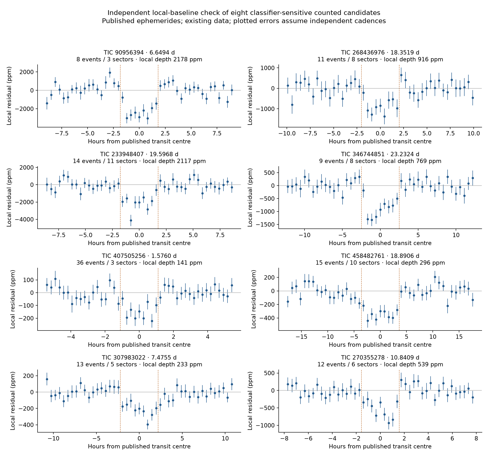
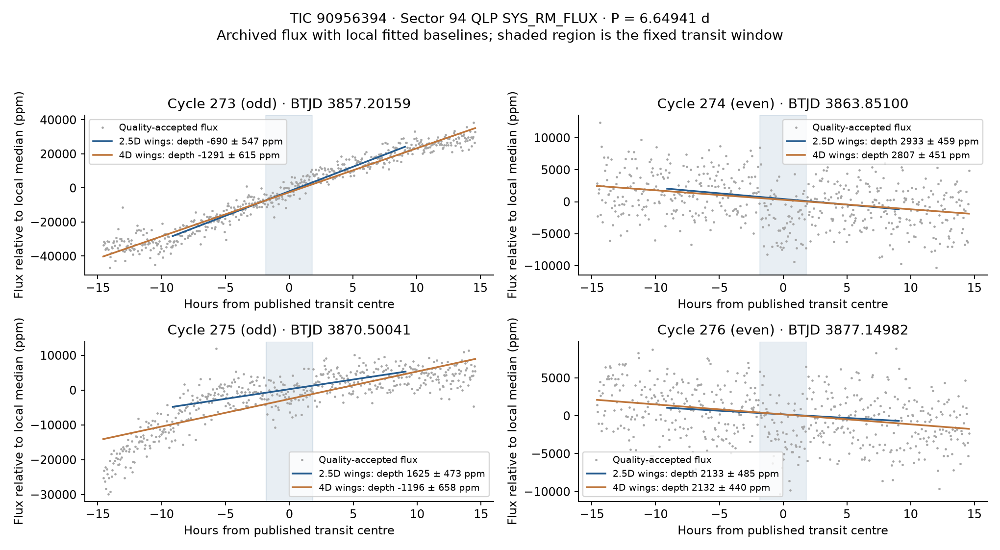
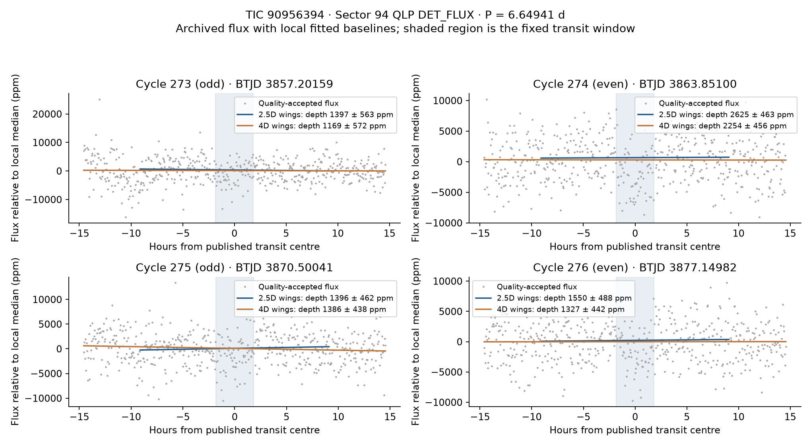

# Independent event checks for 29 classifier-sensitive signals

> **Note added when this was merged (14 October 2026).** The two odd-cycle events of TIC 90956394 in Sector 94 fall
> 0.9 and 1.6 days after the first cadence of a QLP orbit. In Sectors 94–104 QLP's corrected flux ramps for several
> hours after an orbit starts, most strongly in the products with empty uncertainty columns, which is what Sector 94
> is here ([`qlp_orbit_edges.md`](../qlp_orbit_edges.md)); the pipeline now drops the first day and the last half day
> of each orbit there. The odd-even difference below is better explained by that systematic than by a doubled period.
> Since this snapshot the classifier was retrained after the QLP re-search and tier L1 re-selected: of the eight
> counted candidates discussed here, TIC 458482761, 407505256 and 270355278 are again in tier L1, TIC 268436976,
> 233948407 and 346744851 are in tier L, and TIC 90956394 and 307983022 are likely false alarms
> ([`false_alarm_classifier.md`](../false_alarm_classifier.md#retraining-after-the-qlp-re-search-13-october-2026)).

The star-grouped classifier in [PR #4](https://github.com/eumemic/exoplanets/pull/4)
changes membership at `score_h >= 0.80` for 29 clean, low-band signals: 15 enter and
14 leave. We remeasured all 29 at their published ephemerides using local linear
baselines and 210 public TESS light-curve products. Eight are counted tier L1
candidates in the input snapshot; all eight leave the classifier selection.

Seven of these eight retain positive dips with both baseline widths and after
omitting any one measured sector. **TIC 90956394 requires closer review:** its
Sector 94 product was previously discarded for missing uncertainties, and the
recovered odd-cycle measurements depend on both the local baseline and QLP flux
column. The measurements do not settle its period or disposition.

This is a check of detrending sensitivity on selected signals in existing data.
It is not a blind recovery, a prospective test, a calibrated false-alarm test,
host localization or planet validation. Catalogs and tiers are unchanged.

## Sample and provenance

The frozen inputs come from commit
[`ec8311b`](https://github.com/eumemic/exoplanets/tree/ec8311b19a61092ad5eae3d34e947b14485d363e).
The grouped scores use classifier commit `ade1e93`. The 29 catalog ephemerides and
tiers were checked to be unchanged at `d6594be`, after PR #4 merged.
[source_snapshot.json](source_snapshot.json) records the input hashes and package
versions. [signals.csv](signals.csv) records both scores, selection direction,
period, epoch, duration and original tier. Period matching to the catalog requires
one match on the same TIC within 0.3%; ambiguous matches fail.

A MAST query returned 355 light-curve products in
[available_products.csv](available_products.csv). One per star and sector was
selected, preferring SPOC exposures of at least 100 seconds, then TESS-SPOC, then
QLP, with URI order breaking ties. The 210 selected products comprise 14 SPOC,
119 TESS-SPOC and 77 QLP files, totaling 133,859,520 bytes. Sectors span 3–100;
**none is later than the discovery search's Sector 104 limit**.
[products.csv](products.csv) preserves exact archive URIs, URLs, sizes and SHA256
hashes. FITS files remain downloadable inputs, not committed artifacts. A replay
fails on a hash mismatch, including an archive redelivery, rather than silently
combining new data with this frozen report.

## Measurement

The measurement code imports no discovery search or detrending implementation.
It uses `PDCSAP_FLUX` for SPOC/TESS-SPOC, `SYS_RM_FLUX` for QLP where present and
otherwise `SAP_FLUX`. Only `QUALITY == 0`, finite positive flux and valid errors
are accepted. This is stricter than the discovery pipeline's bitmask. Times are
sorted and deduplicated; each sector is normalized by its median flux.

QLP Sector 94 has entirely NaN selected errors for TIC 90956394 and TIC 346744851.
The original reader drops both products; see
[issue #5](https://github.com/eumemic/exoplanets/issues/5) and
[PR #6](https://github.com/eumemic/exoplanets/pull/6). Here we estimate a constant
white cadence error only when no supplied error is usable: the MAD of adjacent
flux differences, scaled by `1.4826 / sqrt(2)`. We exclude differences spanning
more than 1.5 median positive cadence spacings and require at least ten differences
and positive scatter. This independently implemented rule is stricter than PR #6's
three-spacing/three-difference minimum. It recovers 8,822 and 8,011 quality-zero
points respectively. [product_quality.csv](product_quality.csv) makes the error
source and accepted count explicit for every product. All 210 have usable points.

Let `D` be the published full transit duration. For each predicted event:

1. Fit a weighted linear baseline using wings at `|t - centre| >= 0.75D`, inside
   half-windows of `2.5D` and `4D` (capped at `0.4P`). Apply up to three symmetric
   four-scatter clipping updates to the wings. Do not clip the transit core.
2. Require at least half the expected core cadences (minimum two) inside `D/2`,
   and at least three wing points on each side. Missing events are omitted, not
   treated as non-detections.
3. Measure the weighted mean core deficit relative to the fitted baseline.
   Propagate cadence and baseline-fit variance, inflating by at least the wing
   reduced chi-square.
4. Combine events with inverse-variance weights. Report both formal white-noise
   error and an error inflated by at least the event-depth reduced chi-square.
   `snr_event` is depth divided by this latter error: a **diagnostic ratio**, not
   calibrated Gaussian significance or the discovery MES.

The audit also records sector measurements, the minimum diagnostic ratio after
leaving out one sector, odd/even depths and the largest single-event information
fraction. Shifted-phase controls use the same period at 49 equally spaced phase
offsets, exclude centres within `2D` of the real phase and mask real transits from
their core and wings. Coverage leaves 39–49 measurable controls per signal.
These correlated, fixed-period controls do not include the original period search
or selection trials and cannot estimate a survey false-alarm rate.

## Counted candidates

Values below use the `2.5D` half-window unless specified. The error is the
event-scatter-inflated estimate. The diagnostic ratios should not be read as
planet-confirmation significance.

| TIC | Events / sectors | Depth ± error (ppm) | Ratio, 2.5D | Ratio, 4D |
|---|---:|---:|---:|---:|
| 90956394 | 8 / 3 | 2178 ± 544 | 4.01 | 2.75 |
| 268436976 | 11 / 8 | 916 ± 131 | 6.97 | 5.68 |
| 233948407 | 14 / 11 | 2117 ± 270 | 7.85 | 8.61 |
| 346744851 | 9 / 8 | 769 ± 85 | 9.08 | 9.67 |
| 407505256 | 36 / 3 | 141 ± 21 | 6.84 | 7.33 |
| 458482761 | 15 / 10 | 296 ± 41 | 7.28 | 7.10 |
| 307983022 | 13 / 5 | 233 ± 25 | 9.26 | 9.81 |
| 270355278 | 12 / 6 | 539 ± 80 | 6.76 | 6.98 |

For the seven apart from TIC 90956394, the minimum ratio after omitting any one
measured sector is 5.02–8.14 with the narrower window and 4.96–8.57 with the wider
one. No shifted-phase control exceeds any of the eight observed ratios. Across
all 29 signals, the only exception is non-counted tier L TIC 200278116: its
narrow-window ratio is 1.12 from two events in one sector, and 7/44 controls meet
or exceed it. This small selected sample cannot calibrate candidate reliability.



This figure bins local residuals by time from the published centre. Its plotted
standard errors assume independent cadences; it can conceal event differences.
The full [summary](summary.csv), [events](events.csv), [sectors](sectors.csv) and
[controls](phase_controls.csv) are the numerical record.

## TIC 90956394: unresolved period and detrending sensitivity

(See the note at the top: the odd-cycle events below fall at the start of QLP orbits, where the flux ramps.)

The published ephemeris is `P = 6.64941 d`, `T0 = 2041.91266 BTJD`, `D = 3.65 h`.
Before recovering Sector 94, four accepted events in Sectors 27 and 67 all have
even cycle numbers. Sector 94 adds cycles 273, 274, 275 and 276. Across all three
sectors, the six even events have depths of 2993 ± 331 ppm and 2912 ± 350 ppm for
the two baseline widths. Only two odd events are measured, both in Sector 94.

With `SYS_RM_FLUX`, those odd events average 635 ± 1146 ppm for the narrow window
and -1247 ± 449 ppm for the wide one. Their surroundings contain strong trends;
linear local baselines are a poor description in parts of these windows. The
resulting parity statistic is highly model dependent and should not be treated
as a calibrated rejection.

As a **post hoc sensitivity check**, we measured the same four Sector 94 windows
in all three QLP flux columns, estimating scatter separately in each column.
QLP distinguishes raw aperture flux (`SAP_FLUX`), systematics-corrected flux
(`SYS_RM_FLUX`) and detrended flux (`DET_FLUX`);
see the [QLP release description](https://tess.mit.edu/qlp-update/).

| Flux column | Cycle 273, odd | Cycle 274, even | Cycle 275, odd | Cycle 276, even |
|---|---:|---:|---:|---:|
| SYS_RM_FLUX | -690 / -1291 | 2933 / 2807 | 1625 / -1196 | 2133 / 2132 |
| SAP_FLUX | -2904 / -6865 | 2976 / 2872 | 1559 / -1367 | 2155 / 2137 |
| DET_FLUX | 1397 / 1169 | 2625 / 2254 | 1396 / 1386 | 1550 / 1327 |

Each entry is depth in ppm for `2.5D / 4D`; errors and coverage are in
[qlp_flux_columns.csv](qlp_flux_columns.csv). The even dips persist. The odd
measurements change with the upstream detrending as well as the local baseline.
A doubled period of 13.29882 d is therefore a hypothesis to compare, **not an
established correction**; DET_FLUX retains positive odd-cycle dips. Both columns
come from the same product, so this comparison supplies no independent pixels.





The next discriminating step is an independent pixel extraction with transit and
background/stellar variability modeled jointly, comparison of P and 2P, and host
localization. Neither a planet/binary verdict nor a catalog-period change follows
from this audit.

## Timing sensitivity

[MAST flags a QLP timing error from the second half of Sector 99 through Sector
104, with corrected products being delivered](https://archive.stsci.edu/hlsp/qlp).
Our manifest includes six QLP products in Sectors 99–100 on five stars. We
conservatively omit those entire products' measured events; this is a sensitivity
check, not a timestamp correction. The seven products in Sectors 74–79 use the
separately corrected `v02` files.

[without_qlp99plus.csv](without_qlp99plus.csv) records the recombination for all
signals. Four stars have measured events removed; their mean depths remain
positive under both windows. The only counted candidate affected is TIC 307983022:
its ratios become 8.39 and 8.85, from ten events in four sectors, versus 9.26 and
9.81 with all products. No timing-sensitive data are needed for the seven other
counted candidates' measurements. Fresh corrected files will have to be analyzed
as a new input snapshot.

## Reproduce

Python 3.12 was used. The small [requirements file](requirements.txt) pins direct
dependencies for this audit and the optional classifier rerun; the repository's
full requirements also contain them.

```bash
python -m venv .venv
.venv/bin/pip install -r validation/independent_boundary/requirements.txt
.venv/bin/python pipeline/independent_products.py validation/independent_boundary/signals.csv \
  --manifest validation/independent_boundary/products.csv --out data/independent_vetting
.venv/bin/python pipeline/independent_vet.py validation/independent_boundary/signals.csv \
  --downloads data/independent_vetting/downloads.csv --out results/independent_vetting --controls 49
.venv/bin/python pipeline/independent_sensitivity.py validation/independent_boundary/signals.csv \
  --downloads data/independent_vetting/downloads.csv --events results/independent_vetting/events.csv \
  --tic 90956394 --sector 94 --out results/independent_vetting
.venv/bin/python pipeline/independent_event_plot.py validation/independent_boundary/signals.csv \
  --downloads data/independent_vetting/downloads.csv --tic 90956394 --sector 94 \
  --out results/independent_vetting/tic90956394_sector94.png
.venv/bin/python pipeline/independent_event_plot.py validation/independent_boundary/signals.csv \
  --downloads data/independent_vetting/downloads.csv --tic 90956394 --sector 94 \
  --qlp-flux-column DET_FLUX --out results/independent_vetting/tic90956394_sector94_det.png
.venv/bin/python -m unittest discover -s tests -p 'test_independent_*.py' -v
```

To rebuild the selection, run the grouped classifier as documented in
[false_alarm_classifier.md](../false_alarm_classifier.md), then:

```bash
.venv/bin/python pipeline/independent_sample.py --grouped results/classifier_star.csv.gz \
  --out results/independent_vetting/signals_rebuilt.csv
```

The selection rebuild exactly reproduced all 29 frozen rows, and twelve audit
regressions passed. They cover injected box-depth recovery on sloping baselines,
phase controls, incomplete coverage, one-sided baselines, event-scatter inflation,
missing-error recovery and quality filtering, checksum failures, score alignment
and ambiguous ephemerides. The archive replay verified all 210 checksums.

These measurements use NASA TESS observations distributed through MAST, including
SPOC, TESS-SPOC and the MIT TESS Science Office's QLP products. The QLP data release
is identified by [DOI 10.17909/t9-r086-e880](https://doi.org/10.17909/t9-r086-e880).
